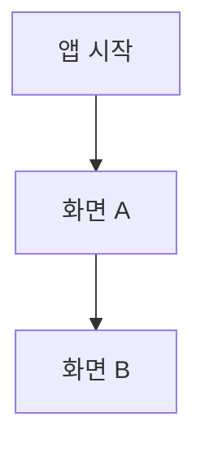

# 공통 기획서

> 프로젝트: [프로젝트명] | 상태: 작성 전 | 작성자: [이름] | 작성일: YYYY-MM-DD | 버전: v0.1

## 문서 목적
[서비스 전체에 적용되는 기획·정책·기준을 정의합니다. 기능별 상세 사항은 features/ 문서를 참조합니다.]

## 1. 프로젝트 개요
- 서비스명:
- 배경 및 목적:
- 서비스 형태 및 대상 플랫폼:

## 2. 문제 정의 및 목표
- 해결할 문제:
- 목표:
- 성공 기준:

## 3. 타깃 사용자 및 경쟁 서비스 분석
### 3.1 타깃 사용자
| 사용자 유형 | 주요 요구 | 사용 상황 |
|---|---|---|
| [유형] | [요구] | [상황] |

### 3.2 경쟁 서비스 분석
| 서비스 | 참고 기능 | 장점 | 한계 및 시사점 |
|---|---|---|---|
| [서비스] | [기능] | [장점] | [시사점] |

## 4. 핵심 가치 및 차별점
- 핵심 가치:
- 차별점:

## 5. MVP 범위 및 제외 범위
| ID | 기능/범위 | 포함 여부 | 우선순위 | 근거 |
|---|---|---|---|---|
| A1 | 회원가입 |  | 필수 |  |
| A2 | 로그인 |  | 필수 |  |
| A2 | 소셜 로그인 |  | 선택 |  |
| A2 | 로그아웃 |  | 필수 |  |
| A2 | 보안 |  | 필수 |  |
| A3 | 계정 관리 |  | 필수 |  |
| B1.1 | 상품 안내·선택 |  | 필수 |  |
| B1.2 | 약관·상품설명서 |  | 필수 |  |
| B1.3 | 통장 비밀번호 |  | 필수 |  |
| B1.4 | 개설 목적·거래정보 |  | 필수 |  |
| B1.5 | 신분증 본인확인 |  | 선택 |  |
| B1.6 | 추가 본인확인 |  | 선택 |  |
| B1.7 | 개설 처리 |  | 필수 |  |
| B1.8 | 개설 완료 |  | 필수 |  |
| B2.1 | 계좌 목록·잔액 |  | 필수 |  |
| B2.2 | 계좌 상세 |  | 필수 |  |
| B2.3 | 거래내역 조회 |  | 필수 |  |
| B2.4 | 거래 상세 |  | 필수 |  |
| B2.5 | 조회조건 |  | 필수 |  |
| B2.6 | 검색 |  | 필수 |  |
| B2.6 | 검색 |  | 선택 |  |
| B2.7 | 거래내역 다운로드 |  | 필수 |  |
| B2.8 | 계좌 상태·한도 확인 |  | 필수 |  |
| B3.1 | 즐겨찾기 |  | 필수 |  |
| B3.2 | 이체한도 |  | 필수 |  |
| B3.3 | 거래중지(잠금) |  | 필수 |  |
| B3.3 | 거래중지(잠금) |  | 필수 |  |
| B4.1 | 해지 가능 여부 확인 |  | 필수 |  |
| B4.2 | 해지 확인·인증 |  | 필수 |  |
| B4.3 | 해지 완료 |  | 필수 |  |
| B5.1 | 소유자 확인 |  | 필수 |  |
| B5.2 | 상태별 허용 동작 |  | 필수 |  |
| C1 | 즉시이체 |  | 필수 |  |
| C1 | 이체한도 |  | 필수 |  |
| C2 | 자동이체 |  | 필수 |  |
| C2 | 예약이체 |  | 선택 |  |
| C3 | 최근·자주 쓰는 계좌 |  | 필수 |  |
| - | 다건이체(급여이체) |  | 선택 |  |
| D1.1 | 발급 신청 |  | 필수 |  |
| D1.2 | 목록 조회 |  | 필수 |  |
| D1.3 | 상세 조회 |  | 필수 |  |
| D1.4 | 재발급 |  | 필수 |  |
| D1.5 | 결제 알림 |  | 필수 |  |
| D1.6 | 부가 기능(상세) |  | 선택 |  |
| D2 | 신용카드 |  | 선택 |  |

## 6. 전체 기능 목록
| 기능 ID | 기능명 | 요약 | 기능별 문서 | 담당자 | 상태 |
|---|---|---|---|---|---|
| A | 회원/인증 | 회원가입, 로그인/로그아웃, 계정 관리 | features/회원_인증.md |  |  |
| B | 계좌 | 개설, 조회(목록·상세·거래내역·다운로드), 계좌 관리(즐겨찾기·이체한도·상태 확인), 해지, 권한·상태 검증 | features/계좌.md |  |  |
| C | 이체 | 즉시이체, 자동이체·예약이체, 최근·자주 쓰는 계좌, 다건이체(선택) | features/이체.md |  |  |
| D | 카드 | 체크카드, 신용카드(선택) | features/카드.md |  |  |
|  | 에이전트 |  | features/에이전트.md |  |  |

## 7. 정보구조도(IA) 및 화면 목록

| 화면 ID | 화면명 | 상위 메뉴 | 관련 기능 ID |
|---|---|---|---|
| [ID] | [화면명] | [메뉴] | [ID] |

## 8. 공통 UX 원칙
- 내비게이션:
- 입력·피드백:
- 로딩·빈 상태·오류 표시:
- 접근성·반응형:

## 9. 디자인 시스템
- 색상·타이포그래피:
- 공통 컴포넌트:
- 디자인 리소스 링크:

## 10. 공통 정책
- 인증·세션·권한:
  - 회원가입 본인확인은 인증번호 인증 방식
  - 로그인은 ID/PW와 간편비밀번호(PIN)를 사용하며 PIN은 필수 (이후 인증에 계속 사용), 생체인증은 제외
  - 로그아웃은 JWT 방식 (수동, 무활동 자동 로그아웃)
  - JWT 인증으로 데이터를 가져오며, 이 토큰으로 소유자 확인
  - 이체한도 변경·계좌 해지·즉시이체 인증은 PIN 이용
  - 거래중지(잠금) 해제는 본인인증(인증번호)
  - 계좌 상태별 허용 동작 (제안, 규정 검토 필요)

| 상태 | 조회 | 입금 | 출금·이체 | 관리 변경 | 해지 |
|---|---|---|---|---|---|
| 정상 | O | O | O | O | O |
| 거래중지 | O | X | X | X | X |
| 해지 | O | X | X | X | X |

- 개인정보·마스킹:
- 공통 보안 및 기록 정책:
  - 로그인 실패 횟수 제한·잠금, 이상 접속 알림
  - 거래중지(잠금) 사유: 비밀번호 오류 누적
- 공통 비기능 요구사항:
  - 이체 도메인 전체: 트랜잭션 처리에 주의
  - 계좌 해지 후에도 사용한 거래내역 data는 보관하고 조회 가능

## 11. 공통 기술 규칙
- 기술적 제약: 자동이체는 실시간 API로는 구현 불가, 스케줄러로 구현
- API 명명·응답·오류 규칙:
- 데이터 식별자 및 형식: 계좌번호 자릿수 3-4-4
- 기능 간 연동 규칙:
  - 계좌(B)는 회원/인증(A)에 의존하고, 이체(C)는 계좌에 의존
  - 체크카드는 계좌에 종속
  - 연결 서비스(체크카드·자동이체)가 있으면 계좌 해지 불가
  - 이체는 공통 함수로 구현하고 자동이체에서 재사용

## 12. 성과 지표·제약·위험
| 구분 | 항목 | 기준/영향 | 대응 |
|---|---|---|---|
| 성과 지표 | [지표] | [목표] | [측정 방식] |
| 제약/위험 | 신용카드 범위 | 상품이며 보통 서비스를 분리해서 개발하기 때문에 범위가 너무 커짐 | 선택사항 |
| 제약/위험 | 자동이체 실시간 구현 | 실시간 API로는 구현 불가 | 스케줄러로 구현 (이체 공통 함수 사용) |
| 제약/위험 | 이체 트랜잭션 | 트랜잭션 처리에 주의 필요 | |
| 제약/위험 | 계좌 상태별 허용 동작 | 제안안이며 규정 검토 필요 | |

## 13. 문서 관리 및 변경 이력
### 결정 사항 및 미해결 이슈
| 날짜 | 이슈/결정 | 담당자 | 상태 |
|---|---|---|---|
| | 카드 도메인 상세 보강 필요 | | |
| | 계좌 상태별 허용 동작은 제안안이며 규정 검토 필요 | | |

### 변경 이력
| 버전 | 날짜 | 변경 내용 | 작성자 |
|---|---|---|---|
| v0.1 | YYYY-MM-DD | 양식 생성 | [이름] |
