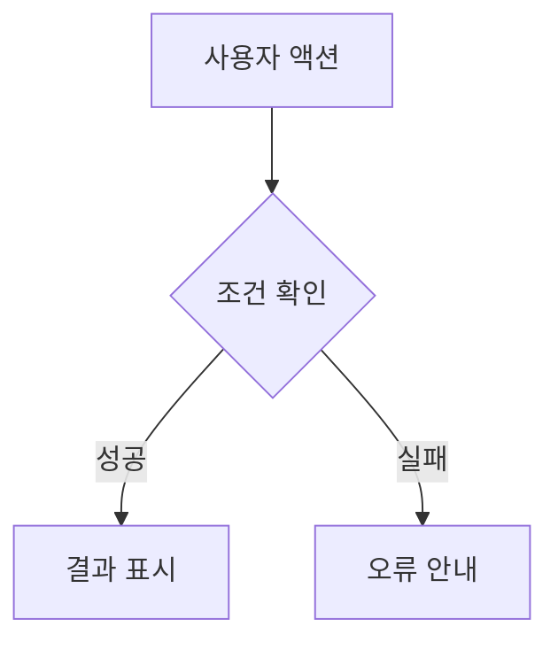

# 계좌 기획서

> 프로젝트: [프로젝트명] | 기능 ID: B | 상태: 작성 전 | 작성자: [이름] | 작성일: YYYY-MM-DD | 버전: v0.1

> 공통 정책과 디자인 규칙은 `00_공통_기획서.md`를 따릅니다. 기능별로 다른 내용만 이 문서에 명시합니다.

## 1. 기능 개요 및 목적
- 기능명: 계좌
- 목적·해결 문제:
- 대상 사용자:
- 사전 조건:
- 관련 기능·의존성: 회원/인증(A)에 의존. 이체(C)와 카드(D)가 계좌에 의존하며(체크카드는 계좌에 종속), 연결 서비스가 있으면 해지 불가

## 2. 기능 요구사항 및 우선순위
| 요구사항 ID | 요구사항 | 상세 설명/조건 | 우선순위 | 담당자 | 상태 |
|---|---|---|---|---|---|
| B1.1 | 상품 안내·선택 | 입출금통장 소개(상품명·연 금리·상품 설명), 신청하기 / 조건: 입출금통장은 상품이 아니라 계좌의 기능으로 포함, 가입 조건 항목은 DB에 없음 | 필수 |  |  |
| B1.2 | 약관·상품설명서 | 상품설명서 확인, 필수/선택 동의, 필수 미동의 시 진행 불가 | 필수 |  |  |
| B1.3 | 통장 비밀번호 | 4자리 설정·확인 | 필수 |  |  |
| B1.4 | 개설 목적·거래정보 | 개설 목적 선택, 거래 관련 질문 응답 | 필수 |  |  |
| B1.5 | 신분증 본인확인 | 신분증 촬영·제출, 실패 시 재촬영 | 선택 |  |  |
| B1.6 | 추가 본인확인 | 요구된 인증 절차 진행, 실패 시 재시도/중단 | 선택 |  |  |
| B1.7 | 개설 처리 | 최종 비밀번호 확인, 계좌번호 발급·중복 방지, 기본 이체한도 자동 부여, 실패 안내 / 조건: 계좌번호 형식 xxx-xxxx-xxxx(하이픈 포함 13자, 중복 불가) / 기본 이체한도: 1일 100만원, 1달 500만원 (수정 가능) | 필수 |  |  |
| B1.8 | 개설 완료 | 신규 계좌 정보 확인, 홈 이동 / 체크카드 신청 연결 | 필수 |  |  |
| B2.1 | 계좌 목록·잔액 | 전체 계좌, 잔액, 즐겨찾기 상단 고정 | 필수 |  |  |
| B2.2 | 계좌 상세 | 계좌번호, 상품, 상태 | 필수 |  |  |
| B2.3 | 거래내역 조회 | 일시·금액·거래 후 잔액, 최신순/오래된순 / 조건: 거래내역(거래원장): DB에서 가져와서 md로 / 거래 유형: 입금·출금·이체·자동이체·카드, 구분: 입금/출금 | 필수 |  |  |
| B2.4 | 거래 상세 | 거래일시·금액·상대방·적요 | 필수 |  |  |
| B2.5 | 조회조건 | 기간, 입금/출금 구분, 정렬 / 조건: 기본값: 기간 3개월, 구분 전체, 최신순 (수정 가능) | 필수 |  |  |
| B2.6 | 검색 | 기간, 금액·금액범위, 상대방(입금자명·예금주), 적요·메모, 거래유형(입금·출금·계좌이체·자동이체·카드) | 필수 |  |  |
| B2.6 | 검색 | 거래상태(정상·취소·실패), 거래번호, 거래 채널·수단, 거래 후 잔액 / 조건: DB에 거래상태·거래 채널·수단 항목이 없음(거래번호는 거래 ID, 거래 후 잔액은 있음) | 선택 |  |  |
| B2.7 | 거래내역 다운로드 | 기간·이메일 입력 후 신청 / 조건: 신청 내역을 저장하고 이메일로 전달, 신청 상태: 접수 / 발송완료 / 실패 | 필수 |  |  |
| B2.8 | 계좌 상태·한도 확인 | 정상/거래중지 상태, 이체한도 현황 / 조건: 계좌 상태: 정상 / 비활성화(거래중지), 계좌한도 포함 | 필수 |  |  |
| B3.1 | 즐겨찾기 | 등록·해제 (홈 상단 고정) | 필수 |  |  |
| B3.2 | 이체한도 | 조회(1일·1달), 변경(PIN 인증) / 조건: 계좌 관리의 인증은 PIN 이용 / 기본값 1일 100만원, 1달 500만원 (수정 가능) | 필수 |  |  |
| B3.3 | 거래중지(잠금) | 상태 조회 / 조건: 거래중지 사유: 통장 비밀번호 오류 누적 (계좌별 실패 횟수 저장, 기준 횟수는 미정) | 필수 |  |  |
| B3.3 | 거래중지(잠금) | 해제(이메일 본인인증) / 조건: 통장 비밀번호 오류 누적으로 거래중지 → 이메일 인증번호 본인인증으로 해제 | 필수 |  |  |
| B4.1 | 해지 가능 여부 확인 | 잔액, 연결 서비스(체크카드·자동이체), 계좌 상태 점검, 해지 제한 사유 안내 문구 / 조건: 연결 서비스가 없으면 바로 해지로 진행 / 연결 서비스가 있거나 잔액이 남아 있으면 해지 불가, 제한 사유 안내 메시지 표시 | 필수 |  |  |
| B4.2 | 해지 확인·인증 | 최종 확인 문구, PIN 인증 (되돌릴 수 없음) / 조건: 인증은 PIN | 필수 |  |  |
| B4.3 | 해지 완료 | 해지 상태로 전환(이후 계좌 사용 불가), 거래내역 보관·조회 가능 / 조건: 해지 후에도 사용한 거래내역 data는 보관하고 조회 가능 | 필수 |  |  |
| B5.1 | 소유자 확인 | 요청한 계좌가 본인 소유인지 검증 / 조건: JWT 인증으로 데이터를 가져오며, 이 토큰으로 소유자 확인 | 필수 |  |  |
| B5.2 | 상태별 허용 동작 | 아래 표 기준으로 요청 허용/차단 | 필수 |  |  |

## 3. 입력·출력 및 처리 조건
| 구분 | 데이터/항목 | 형식·제약 | 처리 규칙 |
|---|---|---|---|
| 입력 | [항목] | [형식] | [규칙] |
| 출력 | [항목] | [형식] | [규칙] |
- 처리 순서:
  - 계좌 개설: 상품 안내·선택 → 약관·상품설명서 → 통장 비밀번호 → 개설 목적·거래정보 → (선택) 신분증 본인확인 → (선택) 추가 본인확인 → 개설 처리 → 개설 완료
  - 계좌 해지: 해지 가능 여부 확인 → 해지 확인·인증(PIN) → 해지 완료
- 사전·사후 조건:

## 4. 검색·필터·정렬 조건 (해당 시)
| 항목 | 조건/기본값 | 검증·예외 |
|---|---|---|
| 조회기간 | 기본값 3개월 (수정 가능) |  |
| 입금/출금 구분 | 기본값 전체 (수정 가능) |  |
| 정렬 | 기본값 최신순 (수정 가능), 오래된순 |  |
| 검색 (필수) | 기간, 금액·금액범위, 상대방(입금자명·예금주), 적요·메모, 거래유형(입금·출금·계좌이체·자동이체·카드) |  |
| 검색 (선택) | 거래상태(정상·취소·실패), 거래번호, 거래 채널·수단, 거래 후 잔액 |  |

## 5. 사용자 시나리오 및 플로차트
### 주요 유스케이스
- 사용자:
- 시작 조건:
- 기본 흐름:
- 대체·실패 흐름:

## 6. 화면 기본 정보 및 UI 요소
| 화면 ID | 화면명 | 진입 경로 | 관련 요구사항 |
|---|---|---|---|
| [ID] | [화면명] | [경로] | [ID] |

| 요소 ID | UI 요소 | 위치·표시 조건 | 동작·상태 |
|---|---|---|---|
| [ID] | [버튼/입력창 등] | [조건] | [동작] |

- 와이어프레임 링크 또는 이미지:

## 7. 사용자 액션 및 화면 전환
| 현재 화면 | 사용자 액션 | 처리 결과 | 이동 화면 |
|---|---|---|---|
| 개설 완료 | 홈 이동 또는 체크카드 신청 연결 |  | 홈 / 체크카드 신청 |
| 해지 가능 여부 확인 | 연결 서비스와 잔액이 없음 | 바로 해지로 진행 | 해지 확인·인증 |
| 해지 가능 여부 확인 | 연결 서비스가 있거나 잔액이 남아 있음 | 해지 불가, 제한 사유 안내 메시지 표시 |  |
| 해지 확인·인증 | PIN 인증 | 해지 상태로 전환 | 해지 완료 |

## 8. 데이터 표시·마스킹 규칙
| 데이터 | 표시 형식 | 마스킹/노출 조건 |
|---|---|---|
| 계좌번호 | xxx-xxxx-xxxx(13자) |  |

## 9. 입력 검증·오류·예외 처리
| 상황 | 검증·발생 조건 | 사용자 안내 | 후속 처리 |
|---|---|---|---|
| 계좌 개설 약관 동의 | 필수 약관 미동의 |  | 개설 진행 불가 |
| 계좌 개설 처리 | 실패 | 실패 안내 |  |
| 신분증 본인확인 (선택) | 실패 |  | 재촬영 |
| 추가 본인확인 (선택) | 실패 |  | 재시도/중단 |
| 거래중지 | 통장 비밀번호 오류 누적 |  | 이메일 인증번호 본인인증으로 해제 |
| 계좌 해지 | 연결 서비스가 있거나 잔액이 남아 있음 | 제한 사유 안내 메시지 | 해지 차단 |
- 로딩 상태:
- 빈 결과 상태:
- 네트워크/서버 오류:

## 10. 인증·권한·보안 및 비기능 요구사항
- 접근 권한: JWT 인증으로 데이터를 가져오며, 이 토큰으로 소유자 확인
- 민감정보 처리:
- 사용자 승인 필요 여부: 이체한도 변경·계좌 해지는 PIN 인증, 거래중지 해제는 이메일 인증번호 본인인증
- 성능·접근성·안정성 기준:
- 공통 정책 대비 예외: 

상태별 허용 동작 (제안, 규정 검토 필요)

| 상태 | 조회 | 입금 | 출금·이체 | 관리 변경 | 해지 |
|---|---|---|---|---|---|
| 정상 | O | O | O | O | O |
| 거래중지 | O | X | X | X | X |
| 해지 | O | X | X | X | X |

## 11. API·데이터 연계
| API/데이터 ID | 목적 | 요청·입력 | 응답·출력 | 관련 화면 |
|---|---|---|---|---|
| [ID] | [목적] | [입력] | [출력] | [화면] |
- 관련 데이터 엔터티(SQL 테이블): accounts(계좌), account_products(계좌 상품), account_transactions(거래원장), statement_requests(거래내역 다운로드 신청), terms·term_agreements(약관·약관 동의)
- 외부 서비스/Agent 연동 (해당 시):
- 상세 기술 명세 링크:

## 12. 화면별 인수 기준 및 테스트
| 테스트 ID | 화면/요구사항 ID | 시나리오 | 기대 결과 | 상태 |
|---|---|---|---|---|
| [ID] | [ID] | [시나리오] | [결과] | 미실행 |

## 13. 결정 사항·미해결 이슈·변경 이력
### 결정 사항 및 미해결 이슈
| 날짜 | 이슈/결정 | 담당자 | 상태 |
|---|---|---|---|
|  | 계좌 상태별 허용 동작은 제안안이며 규정 검토 필요 |  |  |

### 변경 이력
| 버전 | 날짜 | 변경 내용 | 작성자 |
|---|---|---|---|
| v0.1 | YYYY-MM-DD | 양식 생성 | [이름] |
