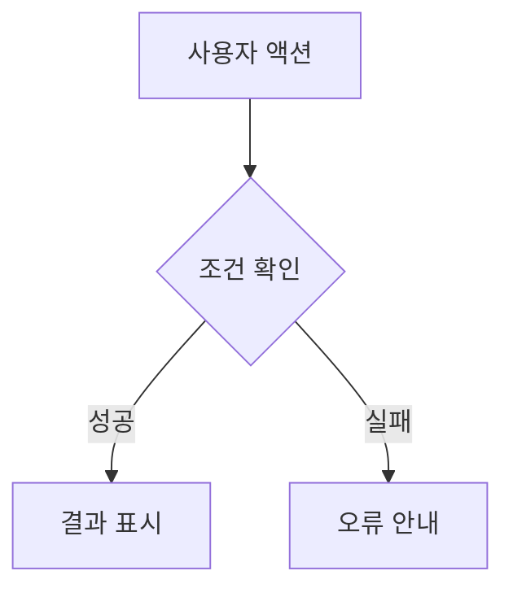

# 에이전트 기획서

> 프로젝트: [프로젝트명] | 기능 ID: [ID] | 상태: 작성 전 | 작성자: [이름] | 작성일: YYYY-MM-DD | 버전: v0.1

> 공통 정책과 디자인 규칙은 `00_공통_기획서.md`를 따릅니다. 기능별로 다른 내용만 이 문서에 명시합니다.

## 1. 기능 개요 및 목적
- 기능명: 에이전트
- 목적·해결 문제:
- 대상 사용자:
- 사전 조건:
- 관련 기능·의존성:

## 2. 기능 요구사항 및 우선순위
| 요구사항 ID | 요구사항 | 상세 설명/조건 | 우선순위 | 담당자 | 상태 |
|---|---|---|---|---|---|
| [ID] | [요구사항] | [조건] | 필수/선택 | [이름] | 예정 |

## 3. 입력·출력 및 처리 조건
| 구분 | 데이터/항목 | 형식·제약 | 처리 규칙 |
|---|---|---|---|
| 입력 | [항목] | [형식] | [규칙] |
| 출력 | [항목] | [형식] | [규칙] |
- 처리 순서:
- 사전·사후 조건:

## 4. 검색·필터·정렬 조건 (해당 시)
| 항목 | 조건/기본값 | 검증·예외 |
|---|---|---|
| [검색/필터/정렬] | [조건] | [예외] |

## 5. 사용자 시나리오 및 플로차트
### 주요 유스케이스
- 사용자:
- 시작 조건:
- 기본 흐름:
- 대체·실패 흐름:

## 6. 화면 기본 정보 및 UI 요소
| 화면 ID | 화면명 | 진입 경로 | 관련 요구사항 |
|---|---|---|---|
| [ID] | [화면명] | [경로] | [ID] |

| 요소 ID | UI 요소 | 위치·표시 조건 | 동작·상태 |
|---|---|---|---|
| [ID] | [버튼/입력창 등] | [조건] | [동작] |

- 와이어프레임 링크 또는 이미지:

## 7. 사용자 액션 및 화면 전환
| 현재 화면 | 사용자 액션 | 처리 결과 | 이동 화면 |
|---|---|---|---|
| [화면] | [액션] | [결과] | [화면] |

## 8. 데이터 표시·마스킹 규칙
| 데이터 | 표시 형식 | 마스킹/노출 조건 |
|---|---|---|
| [데이터] | [형식] | [정책] |

## 9. 입력 검증·오류·예외 처리
| 상황 | 검증·발생 조건 | 사용자 안내 | 후속 처리 |
|---|---|---|---|
| [상황] | [조건] | [문구] | [처리] |
- 로딩 상태:
- 빈 결과 상태:
- 네트워크/서버 오류:

## 10. 인증·권한·보안 및 비기능 요구사항
- 접근 권한:
- 민감정보 처리:
- 사용자 승인 필요 여부:
- 성능·접근성·안정성 기준:
- 공통 정책 대비 예외:

## 11. API·데이터 연계
| API/데이터 ID | 목적 | 요청·입력 | 응답·출력 | 관련 화면 |
|---|---|---|---|---|
| [ID] | [목적] | [입력] | [출력] | [화면] |
- 관련 데이터 엔터티:
- 외부 서비스/Agent 연동 (해당 시):
- 상세 기술 명세 링크:

## 12. 화면별 인수 기준 및 테스트
| 테스트 ID | 화면/요구사항 ID | 시나리오 | 기대 결과 | 상태 |
|---|---|---|---|---|
| [ID] | [ID] | [시나리오] | [결과] | 미실행 |

## 13. 결정 사항·미해결 이슈·변경 이력
### 결정 사항 및 미해결 이슈
| 날짜 | 이슈/결정 | 담당자 | 상태 |
|---|---|---|---|
| YYYY-MM-DD | [내용] | [이름] | 검토 중 |

### 변경 이력
| 버전 | 날짜 | 변경 내용 | 작성자 |
|---|---|---|---|
| v0.1 | YYYY-MM-DD | 양식 생성 | [이름] |
