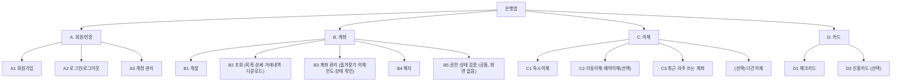
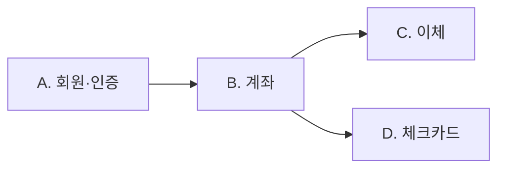
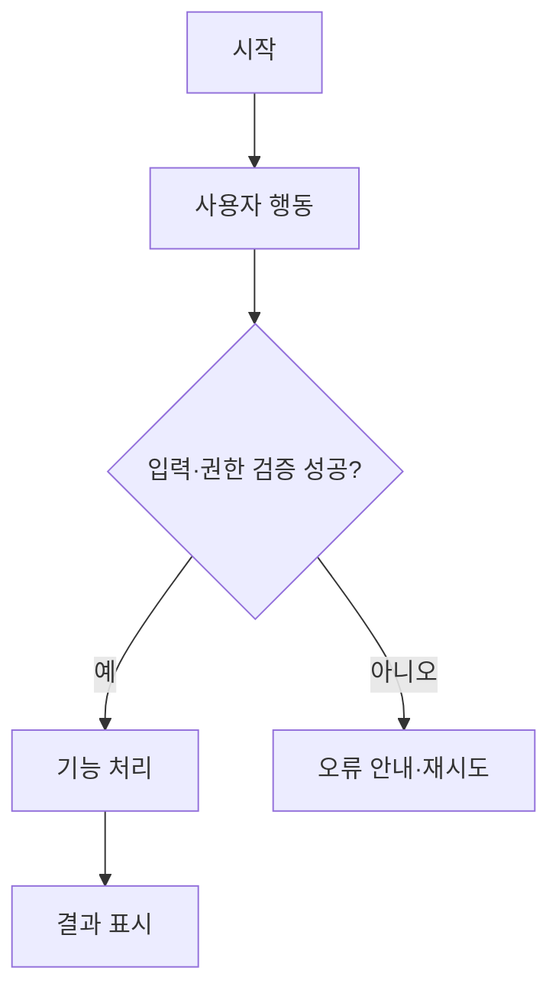

# 금융앱 통합 기획·설계서 (Product Specification)

> 프로젝트: [프로젝트명]  
> 문서 상태: 작성 전 | 버전: v0.1 | 작성일: YYYY-MM-DD | 작성자: [이름]  
> 범위: 금융앱 기본 기능 (AI Agent 제외)

## 1. 목표

### 1.1 프로젝트 배경 및 목적
- 배경: [작성]
- 해결할 문제: [작성]
- 서비스 목표: [작성]

### 1.2 성공 기준
| ID | 목표 | 측정 방법 | 목표값 | 상태 |
|---|---|---|---|---|
| G-01 | [작성] | [작성] | [작성] | 미정 |

## 2. 사용자

| 사용자 유형 | 주요 요구 | 사용 상황 | 권한/제약 |
|---|---|---|---|
| [유형] | [요구] | [상황] | [작성] |

### 주요 사용자 시나리오
- [사용자]는 [상황]에서 [목표]를 달성하기 위해 [행동]한다.

## 3. MVP

### 3.1 포함·제외 범위
| 기능 ID | 기능 | MVP 포함 여부 | 우선순위 | 판단 근거 | 상태 |
|---|---|---|---|---|---|
| A | 회원·인증 | 미정 | 미정 | [작성] | 검토 중 |
| B | 계좌 | 미정 | 미정 | [작성] | 검토 중 |
| C | 이체 | 미정 | 미정 | [작성] | 검토 중 |
| D | 카드 | 미정 | 미정 | [작성] | 검토 중 |

### 3.2 MVP 완료 조건
- [ ] [필수 기능별 완료 기준]
- [ ] [공통 품질 기준]
- [ ] [제외 범위 확인]

## 4. 기능구조도

> 실제 확정된 기능만 남기고 계층과 ID를 조정합니다. 아래는 기존 공통 기획서의 기능 구분을 기반으로 한 구조 작성 틀입니다.



| 상위 ID | 도메인 | 하위 기능 범위 | 기능별 상세 문서 |
|---|---|---|---|
| A | 회원·인증 | 회원가입, 로그인/로그아웃, 계정 관리 | `features/authentication.md` |
| B | 계좌 | 개설, 조회(목록·상세·거래내역·다운로드), 계좌 관리(즐겨찾기·이체한도·상태 확인), 해지, 권한·상태 검증 | `features/accounts.md` |
| C | 이체 | 즉시이체, 자동이체·예약이체(선택), 최근·자주 쓰는 계좌, 다건이체(선택) | `features/transfers.md` |
| D | 카드 | 체크카드, 신용카드(선택) | `features/card.md` |

## 5. 상세기능표

> 모든 기능 ID는 고유해야 합니다. 요구사항, 화면, 테스트에서 동일 ID를 참조합니다.

| 기능 ID | 도메인 | 세부 기능 | 사용자 동작 | 시스템 처리/출력 | 입력·검증 조건 | 우선순위 | 상태 | 추가 메모 |
|---|---|---|---|---|---|---|---|---|
| A1 | 회원·인증 | 회원가입: 약관 동의(필수/선택), 본인확인(인증번호 인증), ID/PW 설정 |  |  |  | 필수 |  | 본인확인은 인증번호 인증 방식 |
| A2 | 회원·인증 | 로그인: ID/PW, 간편비밀번호(PIN) |  |  |  | 필수 |  | PIN 필수 (이후 인증에 계속 편리하게 사용), 생체인증은 제외 |
| A2 | 회원·인증 | 소셜 로그인: 소셜 계정으로 로그인 |  |  |  | 선택 |  |  |
| A2 | 회원·인증 | 로그아웃: 수동, 무활동 자동 로그아웃 |  |  |  | 필수 |  | JWT 방식 |
| A2 | 회원·인증 | 보안: 실패 횟수 제한·잠금, 이상 접속 알림 |  |  |  | 필수 |  |  |
| A3 | 회원·인증 | 계정 관리: 정보 변경, 비밀번호 재설정, 회원 탈퇴 |  |  |  | 필수 |  | CRUD로 구현 |
| B1.1 | 계좌 | 상품 안내·선택: 입출금통장 소개, 신청하기 |  |  |  | 필수 |  | 입출금통장은 상품이 아니라 계좌의 기능으로 포함 |
| B1.2 | 계좌 | 약관·상품설명서: 상품설명서 확인, 필수/선택 동의, 필수 미동의 시 진행 불가 |  |  |  | 필수 |  |  |
| B1.3 | 계좌 | 통장 비밀번호: 4자리 설정·확인 |  |  |  | 필수 |  |  |
| B1.4 | 계좌 | 개설 목적·거래정보: 개설 목적 선택, 거래 관련 질문 응답 |  |  |  | 필수 |  |  |
| B1.5 | 계좌 | 신분증 본인확인: 신분증 촬영·제출, 실패 시 재촬영 |  |  |  | 선택 |  |  |
| B1.6 | 계좌 | 추가 본인확인: 요구된 인증 절차 진행, 실패 시 재시도/중단 |  |  |  | 선택 |  |  |
| B1.7 | 계좌 | 개설 처리: 최종 비밀번호 확인, 계좌번호 발급·중복 방지, 기본 이체한도 자동 부여, 실패 안내 |  |  |  | 필수 |  | 계좌번호 자릿수 3-4-4 / 기본 이체한도: 1일 100만원, 1달 500만원 (수정 가능) |
| B1.8 | 계좌 | 개설 완료: 신규 계좌 정보 확인, 홈 이동 / 체크카드 신청 연결 |  |  |  | 필수 |  |  |
| B2.1 | 계좌 | 계좌 목록·잔액: 전체 계좌, 잔액, 즐겨찾기 상단 고정 |  |  |  | 필수 |  |  |
| B2.2 | 계좌 | 계좌 상세: 계좌번호, 상품, 상태 |  |  |  | 필수 |  |  |
| B2.3 | 계좌 | 거래내역 조회: 일시·금액·거래 후 잔액, 최신순/오래된순 |  |  |  | 필수 |  | 거래내역(거래원장): DB에서 가져와서 md로 |
| B2.4 | 계좌 | 거래 상세: 거래일시·금액·상대방·적요 |  |  |  | 필수 |  |  |
| B2.5 | 계좌 | 조회조건: 기간, 입금/출금 구분, 정렬 |  |  |  | 필수 |  | 기본값: 기간 3개월, 구분 전체, 최신순 (수정 가능) |
| B2.6 | 계좌 | 검색: 기간, 금액·금액범위, 상대방(입금자명·예금주), 적요·메모, 거래유형(입금·출금·계좌이체·자동이체·카드대금) |  |  |  | 필수 |  |  |
| B2.6 | 계좌 | 검색: 거래상태(정상·취소·실패), 거래번호, 거래 채널·수단, 거래 후 잔액 |  |  |  | 선택 |  |  |
| B2.7 | 계좌 | 거래내역 다운로드: 기간·이메일 입력 후 신청 |  |  |  | 필수 |  |  |
| B2.8 | 계좌 | 계좌 상태·한도 확인: 정상/거래중지 상태, 이체한도 현황 |  |  |  | 필수 |  | 계좌 상태: 정상 / 비활성화(거래중지), 계좌한도 포함 |
| B3.1 | 계좌 | 즐겨찾기: 등록·해제 (홈 상단 고정) |  |  |  | 필수 |  |  |
| B3.2 | 계좌 | 이체한도: 조회(1일·1달), 변경(PIN 인증) |  |  |  | 필수 |  | 계좌 관리의 인증은 PIN 이용 / 기본값 1일 100만원, 1달 500만원 (수정 가능) |
| B3.3 | 계좌 | 거래중지(잠금): 상태 조회 |  |  |  | 필수 |  | 거래중지 사유: 비밀번호 오류 누적 |
| B3.3 | 계좌 | 거래중지(잠금): 해제(본인인증) |  |  |  | 필수 |  | 비밀번호 오류 누적으로 거래중지 → 본인인증(인증번호)으로 해제 |
| B4.1 | 계좌 | 해지 가능 여부 확인: 잔액, 연결 서비스(체크카드·자동이체), 계좌 상태 점검, 해지 제한 사유 안내 문구 |  |  |  | 필수 |  | 연결 서비스가 없으면 바로 해지로 진행 / 연결 서비스가 있거나 잔액이 남아 있으면 해지 불가, 제한 사유 안내 메시지 표시 |
| B4.2 | 계좌 | 해지 확인·인증: 최종 확인 문구, PIN 인증 (되돌릴 수 없음) |  |  |  | 필수 |  | 인증은 PIN |
| B4.3 | 계좌 | 해지 완료: 해지 상태로 전환(이후 계좌 사용 불가), 거래내역 보관·조회 가능 |  |  |  | 필수 |  | 해지 후에도 사용한 거래내역 data는 보관하고 조회 가능 |
| B5.1 | 계좌 | 소유자 확인: 요청한 계좌가 본인 소유인지 검증 |  |  |  | 필수 |  | JWT 인증으로 데이터를 가져오며, 이 토큰으로 소유자 확인 |
| B5.2 | 계좌 | 상태별 허용 동작: 아래 표 기준으로 요청 허용/차단 |  |  |  | 필수 |  |  |
| C1 | 이체 | 즉시이체: 계좌번호·금액·받는 분 확인, PIN 확인 |  |  |  | 필수 |  | 트랜잭션 처리 주의 / 이체를 공통 함수로 구현 |
| C1 | 이체 | 이체한도: 1일·1달 한도 검증 (설정은 B3.2) |  |  |  | 필수 |  |  |
| C2 | 이체 | 자동이체: 주기·시작일·종료일 |  |  |  | 필수 |  | 실시간 API로는 구현 불가 → 스케줄러로 구현 (이체 공통 함수 사용), 트랜잭션 처리 주의 |
| C2 | 이체 | 예약이체: 일시 지정 |  |  |  | 선택 |  |  |
| C3 | 이체 | 최근·자주 쓰는 계좌: 목록, 즐겨찾기(별표·북마크) 표시 |  |  |  | 필수 |  |  |
| - | 이체 | 다건이체(급여이체): 여러 수취인 일괄 |  |  |  | 선택 |  |  |
| D1.1 | 카드 | 발급 신청: 연결 계좌 지정, 일일 사용한도, 해외결제 on/off |  |  |  | 필수 |  |  |
| D1.2 | 카드 | 목록 조회: 보유 체크카드 목록 |  |  |  | 필수 |  |  |
| D1.3 | 카드 | 상세 조회: 사용내역, 한도 조회·변경, 분실 신고, 정지 |  |  |  | 필수 |  |  |
| D1.4 | 카드 | 재발급: 재발급 신청 |  |  |  | 필수 |  |  |
| D1.5 | 카드 | 결제 알림: 결제 알림 |  |  |  | 필수 |  |  |
| D1.6 | 카드 | 부가 기능(상세): 캐시백, 교통카드 후불 등 |  |  |  | 선택 |  |  |
| D2 | 카드 | 신용카드: 심사·발급, 이용한도, 청구서·결제일, 결제 계좌, 할부 관리 |  |  |  | 선택 |  | 상품이며 보통 서비스를 분리해서 개발하기 때문에 범위가 너무 커짐 |

계좌 상태별 허용 동작 (제안, 규정 검토 필요)

| 상태 | 조회 | 입금 | 출금·이체 | 관리 변경 | 해지 |
|---|---|---|---|---|---|
| 정상 | O | O | O | O | O |
| 거래중지 | O | X | X | X | X |
| 해지 | O | X | X | X | X |

### 공통 요구사항 및 예외
- 입력값 검증: [작성]
- 인증·권한 확인: JWT 인증으로 데이터를 가져오며, 이 토큰으로 소유자 확인
- 개인정보 표시·마스킹: [작성]
- 실패·중복 요청 처리: [작성]
- 비기능 요구사항(성능·접근성 등): 이체 도메인 전체 트랜잭션 처리 주의

## 6. 도메인 의존관계 (AI Agent 제외)

> 아래 관계는 기존 기획서에 기재된 관계를 정리한 것으로, 실제 구현 설계 시 확정합니다.



| 의존 도메인 | 선행/연계 도메인 | 의존 이유 | 처리·제약 조건 | 확정 여부 |
|---|---|---|---|---|
| 계좌 | 회원·인증 | 계좌 소유자·접근 권한 확인 | JWT 토큰으로 소유자 확인 | 검토 필요 |
| 이체 | 계좌 | 잔액·상태·한도 확인 | [작성] | 검토 필요 |
| 체크카드 | 계좌 | 연결 계좌 필요 | 체크카드는 계좌에 종속 | 검토 필요 |

- 도메인 간 공통 처리·재사용 함수: 이체를 공통 함수로 구현하고, 자동이체(스케줄러)에서 사용
- 연계 해제·계좌 해지 시 제약: 연결 서비스(체크카드·자동이체)가 있거나 잔액이 남아 있으면 해지 불가
- 순환 의존 및 데이터 정합성 위험: [작성]

## 7. 사용자 행동과 처리 흐름 (사용 흐름)

### 7.1 사용자 시나리오
| 흐름 ID | 사용자 | 시작 조건 | 사용자 행동 | 시스템 처리 | 결과/다음 화면 | 관련 기능 ID |
|---|---|---|---|---|---|---|
| FLOW-001 | [작성] | [작성] | [작성] | [작성] | [작성] | [ID] |

### 7.2 플로차트


- 정상 흐름: [작성]
- 실패·취소·재시도 흐름: [작성]
- 화면 전환 조건: [작성]

## 8. 와이어프레임

> 실제 이미지, Figma 링크 또는 Markdown 스케치로 교체합니다.

| 화면 ID | 화면명 | 목적 | 주요 영역 | 와이어프레임 링크 | 관련 기능 ID |
|---|---|---|---|---|---|
| SCR-001 | [작성] | [작성] | [작성] | [링크] | [ID] |

### 화면별 배치 스케치
```text
┌───────────────────────────────┐
│ 상단 제목 / 내비게이션         │
├───────────────────────────────┤
│ 핵심 정보 또는 입력 영역       │
│                               │
│ 목록 / 상세 정보 영역          │
├───────────────────────────────┤
│ 주요 행동 버튼                 │
└───────────────────────────────┘
```

## 9. 화면설계도

### 9.1 화면 명세
| 화면 ID | UI 요소 ID | 요소/위치 | 표시 데이터 | 사용자 액션 | 동작·전환 | 유효성/권한 | 상태별 표시 |
|---|---|---|---|---|---|---|---|
| SCR-001 | UI-001 | [작성] | [작성] | [작성] | [작성] | [작성] | [작성] |

### 9.2 화면 상태 및 표시 정책
- 초기/기본 상태: [작성]
- 로딩 상태: [작성]
- 빈 결과: [작성]
- 입력 오류: [작성]
- 서버 오류: [작성]
- 성공·실패 피드백: [작성]
- 개인정보 마스킹 및 접근성: [작성]

### 9.3 화면별 인수 기준
- [ ] [SCR-001] [구체적인 화면 완료 조건]

## 10. 테스트 시나리오

> 기능·오류·보안 검증을 모두 포함하며, 실제 서비스의 보안 요구사항은 별도 검토가 필요합니다.

| 테스트 ID | 분류 | 관련 기능/화면 | 사전 조건 | 수행 절차·입력 | 기대 결과 | 우선순위 | 결과 |
|---|---|---|---|---|---|---|---|
| TC-F-001 | 기능 | [ID] | [작성] | [정상 입력] | [정상 처리·표시] | 필수 | 미실행 |
| TC-E-001 | 오류 | [ID] | [작성] | [잘못된 입력·실패 상황] | [오류 안내·안전한 복구] | 필수 | 미실행 |
| TC-S-001 | 보안 | [ID] | [작성] | [미인증·권한 없는 접근] | [접근 차단·민감정보 미노출] | 필수 | 미실행 |

### 테스트 완료 기준
- [ ] 필수 기능 정상 테스트 통과
- [ ] 오류·예외 처리 검증 완료
- [ ] 인증·인가·민감정보 보호 검증 완료
- [ ] 미해결 결함 및 위험 기록

---

## 결정 사항 및 미해결 이슈
| 날짜 | 관련 항목 | 이슈/결정 | 담당자 | 상태 |
|---|---|---|---|---|
|  | D | 카드 도메인 상세 보강 필요 |  |  |
|  | B5.2 | 계좌 상태별 허용 동작은 제안안이며 규정 검토 필요 |  |  |

## 변경 이력
| 버전 | 날짜 | 변경 내용 | 작성자 |
|---|---|---|---|
| v0.1 | YYYY-MM-DD | 10개 항목 통합 양식 생성 | [작성] |
