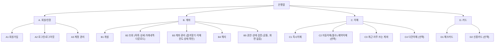
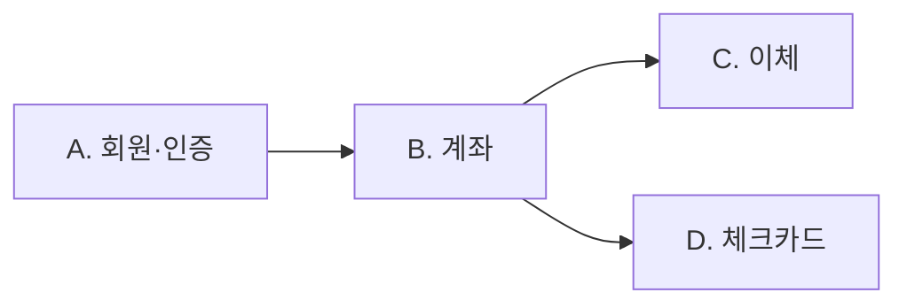
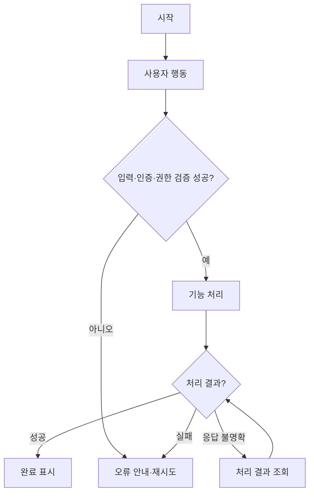
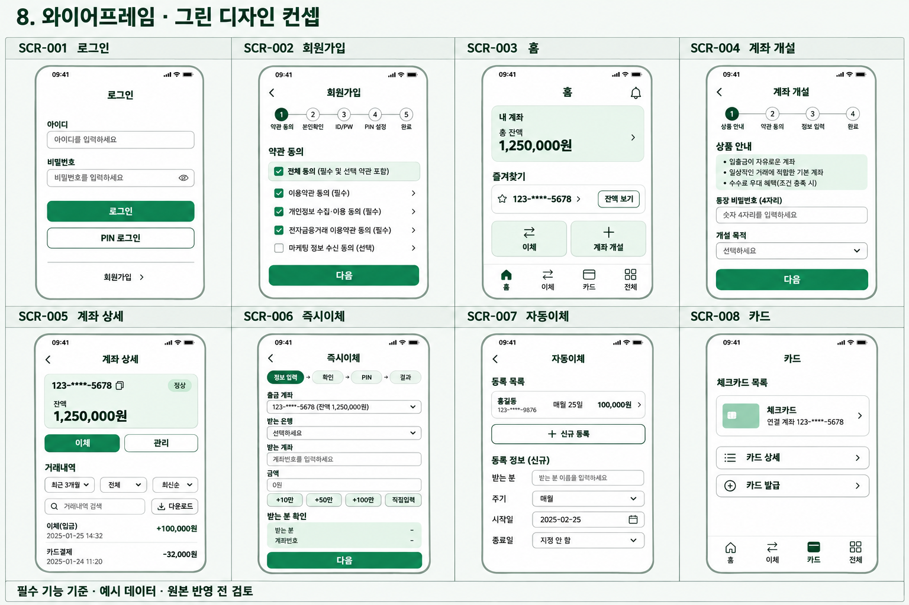
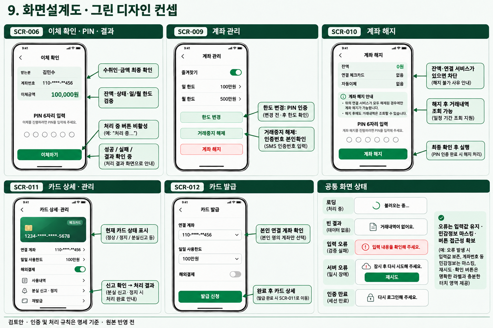

# 금융앱 통합 기획·설계서 (Product Specification)

> 프로젝트: [프로젝트명]  
> 문서 상태: 검토 중 | 작성일: 2026-11-05 | 작성자: [이름]
> 범위: 금융앱 기본 기능 (AI Agent 제외)
> 문서 기준: 본 문서의 범위·화면·공통 정책을 통합 기준으로 사용한다. `features/*.md`는 상세 작성 중인 참고 문서이며, 기존 상위 기능 ID는 본 문서의 하위 ID를 포함한다. 충돌·미정 정책은 하단 미해결 이슈에서 관리한다.
> DB 기준: `Internet Banking_2026-11-05T06_15_28.588Z.sql` 스키마와 일치시킨다. 본인확인은 이메일로 받은 인증번호로 진행한다.

## 1. 목표

### 1.1 프로젝트 배경 및 목적
- 배경: 자주 사용하는 은행 앱, 그리고 토스 같은 슈퍼앱(한 앱에서 계좌·이체·카드 같은 여러 금융 서비스를 이용)의 사용 방식을 참고해 은행 모바일 웹서비스를 클론코딩하는 중간 프로젝트입니다.
- 해결할 문제: 계좌 개설·조회·이체·카드 관리 같은 은행 업무를 모바일 웹에서 본인 인증 후 한 곳에서 처리할 수 있어야 합니다. 로그인한 사용자는 본인 계좌와 기능만 이용할 수 있어야 합니다.
- 서비스 목표: 회원/인증, 계좌, 이체, 카드의 기본 기능을 구현하고, 인증된 사용자가 본인에게 허용된 정보와 기능만 이용하도록 합니다. 자연어 입력과 RAG는 에이전트 기획서에서 별도로 정의합니다.

### 1.2 성공 기준
| ID | 목표 | 측정 방법 | 목표값 | 상태 |
|---|---|---|---|---|
| G-01 | 필수 기능 구현 | README의 확인할 사용 흐름 수행 | 회원/인증, 계좌, 이체, 카드의 필수 기능 동작 | 미정 |
| G-02 | 본인 정보만 이용 | 미인증·타인 계좌 접근 시도 | 접근 차단, 민감정보 미노출 | 미정 |
| G-03 | 실패 상황 동작 확인 | 직접 선정한 실패 상황 수행 | README에 동작 확인 결과 기재 | 미정 |

## 2. 사용자

| 사용자 유형 | 주요 요구 | 사용 상황 | 권한/제약 |
|---|---|---|---|
| 신규 가입자 | 빠른 가입과 첫 계좌 개설 | 앱을 처음 사용하고 첫 계좌를 만들 때 | 이메일 인증번호 본인확인, 필수 약관 동의 후 가입 |
| 일상 금융 이용자 | 잔액·거래내역을 한눈에 확인하고 빠르게 이체 | 평소 계좌를 확인하거나 송금할 때 | 로그인한 본인 계좌만 조회·이체, 이체는 PIN 확인 |
| 계좌 관리 이용자 | 이체한도 변경, 거래중지 해제, 계좌 해지 | 한도를 바꾸거나 통장 비밀번호 오류로 거래가 중지되었을 때 | 한도 변경·해지는 PIN, 해제는 이메일 인증번호 본인인증, 연결 서비스가 있거나 잔액이 남아 있으면 해지 불가 |
| 반복·정기 이체 이용자 | 자주 보내는 계좌로 쉽게 송금, 정기 이체 자동화 | 월세·정기 납부처럼 반복해서 송금할 때 | 자동이체는 스케줄러로 실행, 한도 검증 적용 |
| 카드 이용자 | 체크카드 발급·관리, 분실 시 즉시 조치 | 카드를 새로 쓰거나 잃어버렸을 때 | 체크카드는 연결 계좌에 종속 |

### 주요 사용자 시나리오
- 신규 가입자는 앱을 처음 쓰는 상황에서 첫 계좌를 만들기 위해 이메일로 받은 인증번호로 본인확인을 하고 PIN(6자리)을 설정해 가입한 뒤 입출금 계좌를 개설한다.
- 일상 금융 이용자는 로그인한 뒤 홈에서 계좌 목록과 잔액을 확인하고, 받는 분을 확인한 다음 PIN으로 즉시이체한다.
- 반복·정기 이체 이용자는 최근·자주 쓰는 계좌에서 받는 계좌를 골라 이체하고, 정기 납부는 자동이체(주기·시작일·종료일)로 등록한다.
- 계좌 관리 이용자는 통장 비밀번호 오류가 누적되어 거래중지가 되면 이메일 인증번호 본인인증으로 해제하고, 더 이상 쓰지 않는 계좌는 해지 가능 여부를 확인한 뒤 PIN으로 해지한다.
- 카드 이용자는 연결 계좌를 지정해 체크카드를 발급받고, 분실하면 상세 화면에서 분실 신고와 정지를 한다.

## 3. MVP

### 3.1 포함·제외 범위
| 기능 ID | 기능 | MVP 포함 여부 | 우선순위 | 판단 근거 | 상태 |
|---|---|---|---|---|---|
| A | 회원·인증 | 필수 항목 포함·선택 항목 제외 | 필수 | 가입·로그인·계정 관리 기반 | 본 문서 기준 |
| B | 계좌 | 필수 항목 포함·선택 항목 제외 | 필수 | 개설·조회·관리·해지 및 권한 검증 | 본 문서 기준 |
| C | 이체 | 즉시·자동이체·최근/자주 쓰는 계좌 포함 | 필수 | 일상·정기 송금 흐름 | 본 문서 기준 |
| D | 카드 | 체크카드 필수 항목 포함 | 필수 | 발급·조회·관리·알림 흐름 | 본 문서 기준 |

5절의 ‘필수’ 항목이 본 문서의 MVP 기준이다. 소셜 로그인, 신분증 촬영·추가 본인확인, 확장 거래 검색, 예약이체, 다건이체, 카드 부가기능, 신용카드는 후속 검토 범위로 두며 AI Agent는 별도 문서 범위다. 선택 기능은 구조 파악을 위해 4·5절에 유지하되 8·9절에는 포함하지 않는다.

### 3.2 MVP 완료 조건
- [ ] 5절의 필수 기능이 7절 사용자 흐름 및 9.3절 화면별 인수 기준을 충족한다.
- [ ] 10절 필수 기능·오류·보안 시나리오를 수행하고 결과를 기록한다.
- [ ] 본인 데이터 접근 제어, 중복 처리 방지, 이체 원자성, 민감정보 마스킹을 확인한다.
- [ ] README에 실행 방법·확인 흐름·실패 사례·미해결 제한을 기록한다.
- [ ] 선택 기능을 필수 완료 기준에서 제외하고 미정 정책을 확정 사항으로 구현하지 않는다.

## 4. 기능구조도

> 상위 ID는 기능 묶음이며 5절의 하위 ID를 포함한다. 선택 기능은 후속 검토 범위로 표시한다.

| 상위 ID | 도메인 | 하위 기능 범위 | 기능별 상세 문서 |
|---|---|---|---|
| A | 회원·인증 | 회원가입, 로그인/로그아웃, 계정 관리 | `features/user.md` |
| B | 계좌 | 개설, 조회(목록·상세·거래내역·다운로드), 계좌 관리(즐겨찾기·이체한도·상태 확인), 해지, 권한·상태 검증 | `features/account_transactions.md` |
| C | 이체 | 즉시이체, 자동이체(필수)·예약이체(선택), 최근·자주 쓰는 계좌, 다건이체(선택) | `features/transfers.md` |
| D | 카드 | 체크카드, 신용카드(선택) | `features/card.md` |

## 5. 상세기능표

> 모든 기능 ID는 고유해야 합니다. 요구사항, 화면, 테스트에서 동일 ID를 참조합니다.

| 기능 ID | 도메인 | 세부 기능 | 사용자 동작 | 시스템 처리/출력 | 입력·검증 조건 | 우선순위 | 상태 | 추가 메모 |
|---|---|---|---|---|---|---|---|---|
| A1 | 회원·인증 | 회원가입: 약관 동의(필수/선택), 본인확인(이메일 인증번호), 회원 정보 입력(이름·이메일·휴대폰 번호·생년월일(선택)), ID/PW 설정, PIN 설정 |  | 이메일로 인증번호 발송(목적: 가입)·검증, 비밀번호·PIN·인증번호는 해시 저장, 약관 동의 내역 저장, 회원 상태 정상으로 생성 | 이름·이메일·휴대폰 번호·ID·비밀번호·PIN 필수, 생년월일 선택, ID·이메일·휴대폰 번호 중복 불가, 필수 약관 동의, PIN 6자리 | 필수 |  | 본인확인은 이메일 인증번호 방식(SMS 아님) / PIN은 가입 시 설정, 6자리 고정 |
| A2.1 | 회원·인증 | 로그인: ID/PW 또는 간편비밀번호(PIN) |  | ID/PW 실패 횟수와 PIN 실패 횟수를 각각 누적, 접속 기록(IP·기기·브라우저·성공 여부) 저장 |  | 필수 |  | PIN 필수 (이후 인증에 계속 편리하게 사용), 6자리 고정, 생체인증은 제외 / 회원 상태: 정상 / 잠금 / 탈퇴, 누적 기준 횟수는 미정 |
| A2.2 | 회원·인증 | 소셜 로그인: 소셜 계정으로 로그인 |  |  |  | 선택 |  |  |
| A2.3 | 회원·인증 | 로그아웃: 수동, 무활동 자동 로그아웃 |  |  |  | 필수 |  | JWT 방식 |
| A2.4 | 회원·인증 | 보안: 실패 횟수 제한·잠금, 이상 접속 알림 |  | 접속 기록(IP·기기·브라우저·성공 여부)을 남기고 이상 접속 시 앱 내 알림 생성 |  | 필수 |  | 이상 접속 판단 기준은 미정 |
| A3 | 회원·인증 | 계정 관리: 정보 변경, 비밀번호 재설정(이메일 인증번호), 회원 탈퇴 |  | 재설정은 이메일 인증번호(목적: 비밀번호 재설정) 확인 후 변경, 탈퇴는 회원 상태를 탈퇴로 바꾸고 탈퇴일시 기록 |  | 필수 |  | CRUD로 구현 / 탈퇴 제한 정책은 미정 |
| B1.1 | 계좌 | 상품 안내·선택: 입출금통장 소개(상품명·연 금리·상품 설명), 신청하기 |  |  |  | 필수 |  | 입출금통장은 상품이 아니라 계좌의 기능으로 포함 / 상품 정보는 계좌 상품에서 조회, 가입 조건 항목은 DB에 없음 |
| B1.2 | 계좌 | 약관·상품설명서: 상품설명서 확인, 필수/선택 동의, 필수 미동의 시 진행 불가 |  | 계좌개설 약관(구분: 계좌개설)의 동의 내역 저장 |  | 필수 |  |  |
| B1.3 | 계좌 | 통장 비밀번호: 4자리 설정·확인 |  | 통장 비밀번호는 해시로 저장 |  | 필수 |  |  |
| B1.4 | 계좌 | 개설 목적·거래정보: 개설 목적 선택, 거래 관련 질문 응답 |  | 개설 목적·거래정보를 계좌의 개설 정보로 저장 |  | 필수 |  |  |
| B1.5 | 계좌 | 신분증 본인확인: 신분증 촬영·제출, 실패 시 재촬영 |  |  |  | 선택 |  |  |
| B1.6 | 계좌 | 추가 본인확인: 요구된 인증 절차 진행, 실패 시 재시도/중단 |  |  |  | 선택 |  |  |
| B1.7 | 계좌 | 개설 처리: 최종 비밀번호 확인, 계좌번호 발급·중복 방지, 기본 이체한도 자동 부여, 실패 안내 |  |  |  | 필수 |  | 계좌번호 형식 xxx-xxxx-xxxx(하이픈 포함 13자, 중복 불가) / 기본 이체한도: 1일 100만원, 1달 500만원 (수정 가능) |
| B1.8 | 계좌 | 개설 완료: 신규 계좌 정보 확인, 홈 이동 / 체크카드 신청 연결 |  |  |  | 필수 |  |  |
| B2.1 | 계좌 | 계좌 목록·잔액: 전체 계좌, 잔액, 계좌 별칭, 즐겨찾기 상단 고정 |  |  |  | 필수 |  |  |
| B2.2 | 계좌 | 계좌 상세: 계좌번호, 별칭, 상품, 상태 |  |  |  | 필수 |  |  |
| B2.3 | 계좌 | 거래내역 조회: 일시·금액·거래 후 잔액, 최신순/오래된순 |  |  |  | 필수 |  | 거래내역은 DB 거래원장에서 조회해 화면에 표시. Markdown 내보내기 형식·이메일 전달 방식은 별도 확정 / 거래 유형: 입금·출금·이체·자동이체·카드, 구분: 입금/출금 |
| B2.4 | 계좌 | 거래 상세: 거래일시·금액·상대방·적요 |  | 상대방 이름(카드는 가맹점명)·상대방 계좌번호·적요 표시 |  | 필수 |  |  |
| B2.5 | 계좌 | 조회조건: 기간, 입금/출금 구분, 정렬 |  |  |  | 필수 |  | 기본값: 기간 3개월, 구분 전체, 최신순 (수정 가능) |
| B2.6.1 | 계좌 | 검색: 기간, 금액·금액범위, 상대방(입금자명·예금주), 적요·메모, 거래유형(입금·출금·계좌이체·자동이체·카드) |  |  |  | 필수 |  |  |
| B2.6.2 | 계좌 | 검색: 거래상태(정상·취소·실패), 거래번호, 거래 채널·수단, 거래 후 잔액 |  |  |  | 선택 |  | DB에 거래상태·거래 채널·수단 항목이 없음(거래번호는 거래 ID, 거래 후 잔액은 있음), 후속 검토 |
| B2.7 | 계좌 | 거래내역 다운로드: 기간·이메일 입력 후 신청 |  | 신청 내역(기간·이메일)을 저장하고 이메일로 전달, 신청 상태: 접수 / 발송완료 / 실패 |  | 필수 |  | 파일 형식은 별도 확정 |
| B2.8 | 계좌 | 계좌 상태·한도 확인: 정상/거래중지 상태, 이체한도 현황 |  |  |  | 필수 |  | 계좌 상태: 정상 / 거래중지 / 해지, 계좌한도 포함 |
| B3.1 | 계좌 | 즐겨찾기: 등록·해제 (홈 상단 고정) |  | 계좌별 즐겨찾기 여부 저장 |  | 필수 |  |  |
| B3.2 | 계좌 | 이체한도: 조회(1일·1달), 변경(PIN 인증) |  |  |  | 필수 |  | 한도 변경 인증은 PIN, 거래중지 해제는 인증번호 본인확인 / 기본값 1일 100만원, 1달 500만원 (수정 가능) / 계좌별 1일·1달 한도로 저장 |
| B3.3.1 | 계좌 | 거래중지(잠금): 상태 조회 |  |  |  | 필수 |  | 거래중지 사유: 통장 비밀번호 오류 누적 (계좌별 실패 횟수 저장, 기준 횟수는 미정) |
| B3.3.2 | 계좌 | 거래중지(잠금): 해제(이메일 본인인증) |  |  |  | 필수 |  | 통장 비밀번호 오류 누적으로 거래중지 → 이메일 인증번호(목적: 거래중지 해제) 본인인증으로 해제 |
| B4.1 | 계좌 | 해지 가능 여부 확인: 잔액, 연결 서비스(체크카드·자동이체), 계좌 상태 점검, 해지 제한 사유 안내 문구 |  |  |  | 필수 |  | 잔액 0원·연결 서비스 없음·허용 상태이면 최종 확인·PIN 단계로 진행 / 연결 서비스가 있거나 잔액이 남아 있으면 해지 불가, 제한 사유 안내 메시지 표시 |
| B4.2 | 계좌 | 해지 확인·인증: 최종 확인 문구, PIN 인증 (되돌릴 수 없음) |  |  |  | 필수 |  | 인증은 PIN |
| B4.3 | 계좌 | 해지 완료: 해지 상태로 전환(이후 계좌 사용 불가), 거래내역 보관·조회 가능 |  |  |  | 필수 |  | 해지 후에도 사용한 거래내역 data는 보관하고 조회 가능 / 해지 시 계좌 상태를 해지로 바꾸고 해지일시 기록 |
| B5.1 | 계좌 | 소유자 확인: 요청한 계좌가 본인 소유인지 검증 |  |  |  | 필수 |  | JWT 유효성을 검증한 사용자 ID와 서버의 계좌 소유자 ID를 비교 |
| B5.2 | 계좌 | 상태별 허용 동작: 아래 표 기준으로 요청 허용/차단 |  |  |  | 필수 |  |  |
| C1.1 | 이체 | 즉시이체: 계좌번호·금액·받는 분 확인, PIN 확인 |  | 중복 방지 키로 같은 요청의 중복 처리 차단, 처리 상태(처리중·성공·실패)와 실패 사유 기록, 출금·입금 거래내역 생성 |  | 필수 |  | 트랜잭션 처리 주의 / 이체를 공통 함수로 구현 / 받는 계좌는 본 서비스에 개설된 계좌만 가능(DB에서 입금 계좌가 계좌와 연결 필수) |
| C1.2 | 이체 | 이체한도: 1일·1달 한도 검증 (설정은 B3.2) |  |  |  | 필수 |  |  |
| C2.1 | 이체 | 자동이체: 주기(매주·매월)·실행일·시작일·종료일(선택) |  | 다음 실행일 기준으로 스케줄러가 실행, 상태: 사용중 / 종료 / 해지, 실행 실패 시 앱 내 알림 생성 |  | 필수 |  | API로 자동이체 조건을 등록하고, 예정 시각에 스케줄러가 이체 공통 함수를 실행, 트랜잭션 처리 주의 / 실행일은 매주 월~일, 매월 1~31이라 말일 처리는 별도 확정 |
| C2.2 | 이체 | 예약이체: 일시 지정 |  |  |  | 선택 |  | 일회성 예약은 DB에 없음(선택 기능) |
| C3 | 이체 | 최근·자주 쓰는 계좌: 목록, 즐겨찾기(별표·북마크) 표시, 별칭 |  | 자주 쓰는 받는 계좌는 계좌번호·예금주·별칭으로 저장, 최근 계좌는 별도 저장 없이 이체 내역에서 조회 |  | 필수 |  |  |
| C4 | 이체 | 다건이체(급여이체): 여러 수취인 일괄 |  |  |  | 선택 |  | DB에 없음(선택 기능) |
| D1.1 | 카드 | 발급 신청: 연결 계좌 지정, 일일 사용한도, 해외결제 on/off |  | 카드번호 암호화 저장, 유효기간·카드 브랜드(VISA/MASTER/LOCAL) 저장, 기본값: 일일 사용한도 100만원·해외결제 off |  | 필수 |  |  |
| D1.2 | 카드 | 목록 조회: 보유 체크카드 목록(카드번호는 끝 4자리만 표시) |  |  |  | 필수 |  |  |
| D1.3 | 카드 | 상세 조회: 사용내역, 한도 조회·변경, 분실 신고, 정지 |  | 카드 상태: 정상 / 정지 / 분실 / 재발급됨 / 해지, 사용내역은 카드 결제내역(가맹점명·금액·요청/완료일시) |  | 필수 |  |  |
| D1.4 | 카드 | 재발급: 재발급 신청 |  | 새 카드에 재발급 전 카드를 연결해 기록, 이전 카드는 재발급됨 상태 |  | 필수 |  |  |
| D1.5 | 카드 | 결제 알림: 결제 알림(앱 내 알림) |  | 카드 결제 시 알림 생성, 읽은 일시 저장 |  | 필수 |  |  |
| D1.6 | 카드 | 부가 기능(상세): 캐시백, 교통카드 후불 등 |  |  |  | 선택 |  | DB에 없음(선택 기능) |
| D2 | 카드 | 신용카드: 심사·발급, 이용한도, 청구서·결제일, 결제 계좌, 할부 관리 |  |  |  | 선택 |  | 상품이며 보통 서비스를 분리해서 개발하기 때문에 범위가 너무 커짐 / DB에 없음(선택 기능) |

계좌 상태별 허용 동작 (제안, 규정 검토 필요)

| 상태 | 조회 | 입금 | 출금·이체 | 관리 변경 | 해지 |
|---|---|---|---|---|---|
| 정상 | O | O | O | O | O |
| 거래중지 | O | X | X | X (본인확인 후 거래중지 해제만 예외) | X |
| 해지 | O | X | X | X | X |

### 공통 요구사항 및 예외
- 입력값 검증: PIN 숫자 6자리, 통장 비밀번호 숫자 4자리, 확인값 일치, 이체 금액 양수, 날짜·금액 범위·이메일 형식, ID·이메일·휴대폰 번호 중복 불가 및 필수 동의를 서버에서도 검증한다. 로그인 잠금과 계좌 거래중지는 별도 상태로 구분한다.
- 인증·권한 확인: JWT 유효성을 검증한 사용자 ID와 서버의 계좌 소유자 ID를 비교
- 개인정보 표시·마스킹: 9.2절에 따라 계좌·카드 번호를 기본 마스킹하고, PIN·비밀번호·인증번호는 화면·로그에 평문으로 남기지 않는다. 로그인 비밀번호·PIN·통장 비밀번호·인증번호는 해시로 저장하고, 카드번호는 암호화 저장하며 화면에는 끝 4자리만 표시한다.
- 실패·중복 요청 처리: 이체·발급·해지의 중복 제출을 UI와 서버에서 차단하고, 이체는 중복 방지 키로 같은 요청을 한 번만 처리한다. 이체 응답이 불명확하면 처리 결과를 조회하고, 출금·입금·거래원장·한도 누적을 하나의 트랜잭션으로 일치시킨다.
- 비기능 요구사항(성능·접근성 등): 이체 원자성·동시성 제어, 키보드 접근·레이블·오류 안내·색상 대비를 검증한다. 응답시간·부하 목표는 별도 확정한다.

## 6. 도메인 의존관계 (AI Agent 제외)

> 아래 관계는 기존 기획서에 기재된 관계를 정리한 것으로, 실제 구현 설계 시 확정합니다.

| 의존 도메인 | 선행/연계 도메인 | 의존 이유 | 처리·제약 조건 | 확정 여부 |
|---|---|---|---|---|
| 계좌 | 회원·인증 | 계좌 소유자·접근 권한 확인 | JWT 검증 후 사용자 ID와 서버 계좌 소유자 ID 비교 | 검토 필요 |
| 이체 | 계좌 | 잔액·상태·한도 확인 | 즉시·자동이체가 공통 실행 함수를 사용하고 실행 시 재검증·트랜잭션 처리 | 상세 구현 검토 |
| 체크카드 | 계좌 | 연결 계좌 필요 | 체크카드는 계좌에 종속 | 검토 필요 |

- 도메인 간 공통 처리·재사용 함수: 이체를 공통 함수로 구현하고, 자동이체(스케줄러)에서 사용
- 연계 해제·계좌 해지 시 제약: 연결 서비스(체크카드·자동이체)가 있거나 잔액이 남아 있으면 해지 불가
- 순환 의존 및 데이터 정합성 위험: 계좌 해지와 이체·카드 연결이 동시에 처리되지 않도록 실행 시 상태·연결을 재검증한다. 스케줄러의 같은 회차 중복 실행을 방지하고 실패 시 부분 출금·입금이 남지 않도록 한다.

## 7. 사용자 행동과 처리 흐름 (사용 흐름)

### 7.1 사용자 시나리오
| 흐름 ID | 사용자 | 시작 조건 | 사용자 행동 | 시스템 처리 | 결과/다음 화면 | 관련 기능 ID |
|---|---|---|---|---|---|---|
| FLOW-001 | 신규 가입자 | 비회원이 앱에 접속 | 약관 동의 → 회원 정보 입력 → 이메일 인증번호 본인확인 → ID/PW 설정 → PIN 설정(6자리) | 이메일 인증번호 검증, 중복 확인, PIN 6자리 형식 검증 후 회원 생성 | 로그인 화면 | A1 |
| FLOW-002 | 회원 | 로그아웃 상태 | ID/PW 또는 PIN 방식 선택 후 입력 | JWT로 인증, 실패 횟수 제한·잠금 | 홈(계좌 목록) | A2 |
| FLOW-003 | 로그인한 회원 | 홈에서 계좌 개설 선택 | 상품 안내 → 약관·상품설명서 → 통장 비밀번호 → 개설 목적·거래정보 → 최종 비밀번호 확인 | 계좌번호 발급(xxx-xxxx-xxxx, 중복 방지), 기본 이체한도 부여 | 개설 완료 → 홈 / 체크카드 신청 | B1.1~B1.4, B1.7~B1.8 |
| FLOW-004 | 로그인한 회원 | 홈에서 계좌 선택 | 계좌 상세, 거래내역 조회·검색, 거래 상세, 다운로드 신청 | JWT로 소유자 확인, 기본 조건(3개월·전체·최신순) 적용 | 계좌 상세 / 거래 상세 | B2.1~B2.8, B5.1 |
| FLOW-005 | 로그인한 회원 | 출금 계좌 보유, 거래 가능 상태 | 받는 계좌·금액 입력 → 받는 분 확인 → PIN 확인 | 이체한도 검증, 중복 방지 키 확인, 트랜잭션 처리, 상태별 허용 동작 확인 | 이체 결과 | C1, C3, B5.2 |
| FLOW-006 | 로그인한 회원 | 정기 이체가 필요함 | 자동이체 주기(매주·매월)·실행일·시작일·종료일 등록 | 스케줄러가 이체 공통 함수로 실행 | 자동이체 등록 결과 | C2 |
| FLOW-007 | 로그인한 회원 | 계좌 관리 화면 | 이체한도 조회·변경, PIN 인증 | 한도 갱신 | 한도 현황 | B3.2 |
| FLOW-008 | 로그인한 회원 | 통장 비밀번호 오류 누적으로 거래중지 | 거래중지 상태 확인 → 이메일 인증번호 본인인증 | 인증 성공 시 거래중지 해제 | 계좌 상세(정상) | B3.3 |
| FLOW-009 | 로그인한 회원 | 해지할 계좌 선택 | 해지 가능 여부 확인 → 최종 확인·PIN 인증 | 연결 서비스가 있거나 잔액이 남아 있으면 해지 불가 안내, 아니면 해지 상태로 전환(거래내역은 보관) | 해지 완료 / 해지 불가 안내 | B4.1~B4.3 |
| FLOW-010 | 로그인한 회원 | 카드 메뉴 | 발급 신청(연결 계좌·일일 사용한도·해외결제), 목록·상세 조회, 분실 신고·정지, 재발급 | 연결 계좌 확인 후 카드 처리 | 카드 목록 / 카드 상세 | D1.1~D1.5 |

### 7.2 플로차트

- 정상 흐름: 로그인 → 본인 계좌·카드 조회 → 기능별 입력·확인·필요 인증 → 서버 검증·처리 → 결과 표시. 자동이체는 등록 후 별도 스케줄 실행으로 구분한다.
- 실패·취소·재시도 흐름: 검증 실패는 오류 필드를 수정하고 재시도한다. 최종 제출 전 취소는 이전 화면으로 돌아가며, 제출 후에는 결과를 확인한다. 이체 결과 확인 중에는 새 이체를 중복 실행하지 않는다.
- 화면 전환 조건: 가입 완료 후 SCR-001, 로그인 성공 후 SCR-003, 개설 완료 후 SCR-003/012, 카드 발급 완료 후 SCR-011로 이동한다. 인증 만료 시 재로그인하고, 타인 리소스 요청은 차단한다.

## 8. 와이어프레임

회원·인증, 계좌, 이체, 체크카드의 필수 기능을 기준으로 구성한다. 선택 기능과 AI Agent는 제외한다. 이미지에는 대표 화면을 표시하며, 단계별 화면·보조 화면의 동작은 9절 명세를 따른다. 이미지의 금액·이름·일자·상품 문구는 예시이며 확정 정책으로 사용하지 않는다.

| 화면 ID | 화면명 | 목적 | 주요 영역 | 와이어프레임 링크 | 관련 기능 ID |
|---|---|---|---|---|---|
| SCR-001 | 로그인 | 사용자 인증 | ID/PW, PIN 로그인, 가입, 재설정 | 위 이미지 | A2, A3 |
| SCR-002 | 회원가입 | 신규 회원 생성 | 약관, 회원 정보, 이메일 인증번호, ID/PW, PIN 6자리 | 위 이미지 | A1 |
| SCR-003 | 홈 | 본인 계좌와 잔액 확인 | 계좌 목록, 즐겨찾기, 이체, 계좌 개설, 하단 메뉴 | 위 이미지 | B2.1, B3.1 |
| SCR-004 | 계좌 개설 | 입출금 계좌 개설 | 안내(상품명·연 금리·설명), 약관·설명서, 비밀번호 4자리, 목적·거래정보, 최종 확인, 완료 | 위 이미지 | B1.1~B1.4, B1.7~B1.8 |
| SCR-005 | 계좌 상세·거래내역 | 계좌와 거래 조회 | 상태·잔액, 필터·검색, 거래 목록·상세, 다운로드 신청 | 위 이미지 | B2.2~B2.8, B5.1 |
| SCR-006 | 즉시이체 | 수취인 확인 후 송금 | 출금 계좌, 수취 계좌, 금액, 최근·자주 쓰는 계좌, 확인, PIN, 결과 | 위 이미지 및 9절 이미지 | C1, C3, B5.2 |
| SCR-007 | 자동이체 | 정기 이체 등록·확인 | 목록, 출금·수취 계좌, 금액, 주기(매주·매월)·실행일·시작일·종료일, 등록 결과 | 위 이미지 | C2 |
| SCR-008 | 카드 목록 | 보유 체크카드 조회 | 카드 목록, 연결 계좌, 상세 이동, 발급 진입 | 위 이미지 | D1.2 |
| SCR-009 | 계좌 관리 | 계좌 설정·상태 관리 | 즐겨찾기, 일·월 한도, PIN 인증, 거래중지 해제, 해지 진입 | 9절 이미지 | B3.1~B3.3 |
| SCR-010 | 계좌 해지 | 제한 확인 후 계좌 해지 | 잔액·연결 서비스·상태 검사, 제한 사유, 최종 확인·PIN, 결과 | 9절 이미지 | B4.1~B4.3 |
| SCR-011 | 카드 상세·관리 | 사용내역·상태 관리 | 사용내역, 한도 조회·변경, 해외결제, 분실 신고·정지, 재발급, 결제 알림 | 9절 이미지 | D1.3~D1.5 |
| SCR-012 | 체크카드 발급 | 본인 계좌에 카드 연결 | 연결 계좌, 일일 사용한도, 해외결제 설정, 발급 결과 | 9절 이미지 | D1.1 |
| SCR-013 | 계정 관리 | 회원 정보 관리 | 정보 변경, 비밀번호 재설정, 회원 탈퇴, 로그아웃 | 이미지 미수록·9절 명세 | A2, A3 |

### 화면별 배치 원칙
- 모바일 세로 화면을 기준으로 상단에 제목·뒤로가기, 중앙에 정보·입력·목록, 하단에 주요 행동 버튼을 배치한다.
- 홈·이체·카드·전체를 하단 탐색으로 제공하고, 전체 메뉴에서 계정 관리에 접근한다. 입력 단계에서는 진행 상태와 뒤로가기를 제공한다.
- 이체는 정보 입력 → 받는 분·금액 확인 → PIN → 처리 결과, 개설은 안내·동의 → 정보 입력 → 최종 확인 → 완료 순서로 구분한다. 이미지 한 장에 함께 표시한 요소가 동시에 노출된다는 의미는 아니다.

## 9. 화면설계도

### 9.1 화면 명세
UI 요소 ID는 화면별 접두어로 고유하게 부여한다. 명세에 없는 인증 방법·한도 상한·유지 기간·상품 혜택은 별도 확정 전까지 추가하지 않는다.

| 화면 ID | UI 요소 ID | 요소/위치 | 표시 데이터 | 사용자 액션 | 동작·전환 | 유효성/권한 | 상태별 표시 |
|---|---|---|---|---|---|---|---|
| SCR-001 | UI-001-01 | 중앙 로그인 폼 | ID/PW 또는 PIN 입력 | 로그인 | 성공 시 SCR-003 | 인증정보 검증, 실패 횟수 제한·잠금 | 처리 중 중복 제출 차단, 실패·잠금·이상 접속 알림, 무활동 시 자동 로그아웃 |
| SCR-001 | UI-001-02 | 가입·재설정 링크 | 회원가입, 비밀번호 재설정 | 선택 | 가입 SCR-002, 재설정 절차 | 재설정 시 이메일 인증번호 본인확인 | 완료 후 로그인 안내 |
| SCR-002 | UI-002-01 | 단계별 가입 폼 | 필수·선택 약관, 이름·이메일·휴대폰 번호·생년월일(선택), 이메일 인증번호, ID/PW, PIN | 동의·입력·인증번호 요청·다음 | 회원 생성 후 SCR-001 | 필수 동의, 이메일 인증번호 검증(만료·시도 횟수 기준은 미정), ID·이메일·휴대폰 번호 중복 불가, PIN 숫자 6자리·확인 일치 | 오류 필드 표시, 재시도·취소 |
| SCR-003 | UI-003-01 | 중앙 계좌 목록 | 본인 계좌, 별칭, 잔액, 즐겨찾기 | 계좌 선택·잔액 보기 | SCR-005 | 인증된 본인 계좌만 조회 | 로딩, 계좌 없음, 조회 실패 |
| SCR-003 | UI-003-02 | 주요 버튼·하단 메뉴 | 계좌 개설, 이체, 카드, 전체 | 메뉴 선택 | SCR-004/006/008/013 | 세션 확인 | 현재 메뉴 표시 |
| SCR-004 | UI-004-01 | 단계별 개설 폼 | 안내(상품명·연 금리·설명), 설명서·약관, 비밀번호, 목적·거래정보 | 입력·다음·최종 확인 | 개설 완료 후 홈 또는 SCR-012 | 필수 동의·응답, 비밀번호 숫자 4자리·확인 일치 | 진행 단계, 실패 재시도 |
| SCR-004 | UI-004-02 | 개설 결과 | 신규 계좌번호, 기본 한도 | 홈·체크카드 신청 | SCR-003/012 | 계좌번호 xxx-xxxx-xxxx(13자) 중복 불가, 기본 일 100만원·월 500만원 | 처리 중 중복 신청 차단 |
| SCR-005 | UI-005-01 | 상단 계좌 요약 | 계좌번호, 상품, 상태, 잔액·한도 | 이체·관리·번호 복사 | SCR-006/009 | 소유자 검증, 상태별 허용 동작 | 정상·거래중지·해지 구분 |
| SCR-005 | UI-005-02 | 필터·검색·거래 목록 | 일시, 금액, 거래 후 잔액 | 기간·입출금·정렬, 금액/범위·상대방·적요/메모·거래유형 검색, 거래 선택 | 목록 갱신, 거래 상세 보기 | 기본 3개월·전체·최신순, 기간·금액 범위 검증 | 검색 중, 결과 없음, 오류 |
| SCR-005 | UI-005-03 | 거래 상세·다운로드 | 일시·금액·상대방·적요, 신청 기간·이메일 | 상세 확인·다운로드 신청 | 상세 표시 또는 신청 결과 | 본인 거래, 기간·이메일 형식 검증 | 신청 접수·발송완료·실패 안내, 완료와 접수 구분 |
| SCR-006 | UI-006-01 | 이체 입력·수취인 확인 | 출금 계좌, 최근·자주 쓰는 계좌(별칭), 받는 계좌·금액·받는 분 | 입력·수취인 확인·최근/자주 쓰는 계좌 선택·즐겨찾기 등록/해제·다음 | 최종 확인 → PIN | 본인 출금 계좌, 양수 금액, 수취 계좌 검증(본 서비스 계좌만 가능) | 입력·수취인 조회 오류 |
| SCR-006 | UI-006-02 | PIN·실행·결과 | 수취인·금액 최종 요약, PIN 입력, 처리 결과(처리중·성공·실패) | PIN 입력·이체 실행 | 결과 후 계좌 상세/홈 | PIN 6자리, 잔액·계좌 상태·일/월 한도, 트랜잭션 | 처리 중 중복 실행 차단, 성공·실패·결과 확인 중 |
| SCR-007 | UI-007-01 | 자동이체 목록·등록 | 출금·수취 계좌, 금액, 주기(매주·매월)·실행일·시작일·종료일(선택) | 등록·결과 확인 | 목록 갱신 | 본인 계좌, 양수 금액, 날짜·주기 유효성 | 빈 목록, 등록 중, 등록 성공·실패 |
| SCR-007 | UI-007-02 | 등록 결과 안내 | 자동이체 등록 내역 | 내역 확인 | SCR-007 | 스케줄러가 공통 이체 함수로 실행·실행 시 한도 검증 | 등록 완료와 실제 송금 완료 구분 |
| SCR-008 | UI-008-01 | 카드 목록 | 본인 체크카드, 끝 4자리 번호, 연결 계좌·상태 | 카드·발급 선택 | SCR-011/012 | 본인 카드만 조회 | 로딩, 카드 없음, 오류 |
| SCR-009 | UI-009-01 | 즐겨찾기·한도 | 즐겨찾기, 일·월 한도 | 변경·PIN 확인 | 반영 후 관리 화면 | 본인 계좌, 상태 검증, 한도 변경 PIN 인증 | 저장 중, 성공·오류 |
| SCR-009 | UI-009-02 | 거래중지 해제 | 중지 상태·해제 안내 | 이메일 인증번호 요청·입력 | 성공 시 정상 상태 갱신 | 본인확인 성공 후 해제 | 인증 오류·실패·완료 |
| SCR-010 | UI-010-01 | 해지 조건·실행 | 잔액, 체크카드·자동이체 연결, 계좌 상태, 되돌릴 수 없음 안내 | 최종 확인·PIN·해지 | 해지 결과, 거래내역 조회 | 잔액·연결 서비스가 있으면 차단, 허용 상태·소유자·PIN 검증 | 제한 사유, 처리 중, 완료·실패 |
| SCR-011 | UI-011-01 | 카드 정보·설정 | 상태, 사용내역, 한도, 해외결제 설정 | 조회·설정 변경 | 상세 갱신 | 본인 카드·연결 계좌 검증 | 정상·분실·정지 등 현재 상태 |
| SCR-011 | UI-011-02 | 분실·정지·재발급 | 확인 안내, 처리 결과 | 확인 후 신청 | 결과 후 카드 상세 | 본인 카드, 현재 상태 검증 | 중복 제출 차단, 성공·실패 |
| SCR-011 | UI-011-03 | 결제 알림·사용내역 | 결제 결과·사용내역 | 알림·내역 선택 | 관련 사용내역 표시 | 본인 내역만 표시 | 알림 없음, 조회 실패 |
| SCR-012 | UI-012-01 | 발급 신청 폼 | 연결 계좌, 일일 사용한도, 해외결제 on/off | 설정·발급 신청 | 완료 후 SCR-011 | 본인 연결 계좌·상태·입력값 검증 | 계좌 없음, 신청 중, 완료·실패 |
| SCR-013 | UI-013-01 | 계정 관리 | 본인 정보, 정보 변경·재설정·탈퇴·로그아웃 | 메뉴 선택·최종 확인 | 결과 표시, 로그아웃·탈퇴 후 SCR-001 | 본인만 접근, 민감 변경 본인확인 절차 적용 | 저장 중·실패·완료, 탈퇴 제한 정책은 별도 확정 |

### 9.2 화면 상태 및 표시 정책
- 디자인: 딥그린 `#123D32`(제목·강조), 에메랄드 `#16805D`(주요 버튼), 민트 `#EAF5EF`(선택·안내 배경), 밝은 배경 `#F5F8F6`, 흰색 `#FFFFFF`(카드·입력 영역)을 사용한다. 오류·분실·해지에는 의미가 분명한 빨강을 유지한다.
- 초기/기본 상태: 본인 데이터만 조회하고, 계좌 거래내역은 3개월·전체·최신순을 적용한다. 최종 처리 버튼은 필수 입력·확인 조건이 충족될 때 활성화한다.
- 로딩 상태: 목록에는 로딩 표시를, 제출에는 처리 중 문구와 버튼 비활성을 제공한다. 이체·발급·해지의 중복 요청은 서버에서도 방지한다.
- 빈 결과: 계좌·카드 없음과 검색 결과 없음을 구분하고 계좌 개설·카드 발급·검색조건 변경으로 연결한다.
- 입력 오류: 해당 입력 아래에 원인과 수정 방법을 표시한다. 일반 입력은 유지하되 PIN·비밀번호·인증번호는 해당 입력을 초기화하며 클라이언트 영구 저장·평문 로그·자동 복원하지 않는다. 서버 인증용 자격증명은 공통 보안 설계에 따른다.
- 서버 오류: 재시도 가능한 조회 오류에는 재시도 버튼을 제공한다. 이체 응답이 불명확하면 실패로 단정하지 않고 결과 확인 중으로 표시하며, 처리 결과 조회 후 재시도 여부를 안내한다.
- 성공·실패 피드백: 이체 결과에는 금액·받는 분·처리 상태를 표시한다. 자동이체 등록·다운로드 신청 접수는 실제 실행·전달 완료와 구분한다. 변경 실패 시 성공한 것으로 표시하지 않는다.
- 인증·권한: 인증 만료 시 재로그인을 안내하고, 타인 계좌·카드·거래 접근은 서버에서 차단한다. 계좌 상태별 허용 동작은 5절 제안표와 연계하며 최종 정책 확정이 필요하다.
- 개인정보 마스킹 및 접근성: 계좌·카드 번호는 기본 마스킹하고 필요한 상세 확인·복사만 명시적 동작으로 제공한다. PIN은 입력 자릿수만 표시한다. 입력 레이블·키보드 포커스·오류 안내를 제공하고 색상 외 문구·아이콘을 함께 사용한다. 실제 구현에서 텍스트 대비를 검증한다.
- 이미지 해석: 이미지의 상품 혜택·수수료·SMS 채널·거래내역 보관 기간 등 예시 문구는 정책 확정이 아니다. 본인확인은 이메일 인증번호 방식에 따르며(SMS 아님), 보관 기간·혜택·수수료는 별도 정의한다. 이미지와 명세가 다르면 본문 명세를 우선한다.

### 9.3 화면별 인수 기준
- [ ] [SCR-001] ID/PW·PIN 로그인 성공 시 홈 이동, 실패·잠금·인증 만료 안내가 동작한다.
- [ ] [SCR-002] 필수 약관 미동의·이메일 인증 실패·중복 ID/이메일/휴대폰 번호·PIN 형식/확인 불일치 시 가입이 차단된다.
- [ ] [SCR-003] 본인 계좌만 표시하고 즐겨찾기를 상단에 배치하며 빈 계좌 상태에서 개설로 이동한다.
- [ ] [SCR-004] 필수 단계 완료 후에만 개설되고 계좌번호 중복을 방지하며 기본 한도와 완료 화면을 제공한다.
- [ ] [SCR-005] 기본 조회조건·필터·필수 검색조건이 적용되고 거래 상세·기간/이메일 기반 다운로드 신청이 동작한다.
- [ ] [SCR-006] 수취인·금액 확인과 PIN 인증 후 실행하며 잔액·상태·일/월 한도 위반, 중복 송금, 타인 계좌 사용을 차단한다. 응답 유실 시 결과를 확인한다.
- [ ] [SCR-007] 유효한 주기·기간·계좌·금액으로 등록하고 등록 결과와 스케줄러 실행 결과를 구분한다.
- [ ] [SCR-008] 본인 카드 목록·빈 상태·오류 상태를 표시하고 상세·발급으로 이동한다.
- [ ] [SCR-009] 즐겨찾기 변경, PIN 기반 한도 변경, 이메일 인증번호 본인확인 기반 거래중지 해제가 동작한다.
- [ ] [SCR-010] 잔액·연결 서비스·상태에 따른 제한을 표시하고 허용되는 경우에만 최종 확인·PIN 후 해지하며 거래내역 조회를 유지한다.
- [ ] [SCR-011] 사용내역·한도 변경·분실 신고·정지·재발급·결제 알림이 본인 카드에 한해 동작하고 결과·현재 상태를 표시한다.
- [ ] [SCR-012] 본인 연결 계좌와 유효한 설정으로 카드 발급 후 상세 화면으로 이동하며 중복 신청을 방지한다.
- [ ] [SCR-013] 본인 정보 변경·비밀번호 재설정·탈퇴·로그아웃이 정의된 인증·정책에 따라 동작하고 종료 후 인증정보를 폐기한다.
- [ ] [공통] 모바일 화면에서 주요 버튼·입력·오류 문구가 가려지지 않고 로딩·빈 결과·오류·성공 상태 및 키보드 접근을 확인한다.

## 10. 테스트 시나리오

> 기능·오류·보안 검증을 모두 포함하며, 실제 서비스의 보안 요구사항은 별도 검토가 필요합니다.

| 테스트 ID | 분류 | 관련 기능/화면 | 사전 조건 | 수행 절차·입력 | 기대 결과 | 우선순위 | 결과 |
|---|---|---|---|---|---|---|---|
| TC-F-001 | 기능 | A1 / SCR-002 | 비회원 | 필수 약관·이메일 인증번호·PIN 6자리로 가입 | 회원 생성 후 로그인 이동 | 필수 | 미실행 |
| TC-F-002 | 기능 | A2.1 / SCR-001 | 가입 완료 | ID/PW 또는 허용된 PIN 방식으로 로그인 | 본인 홈 이동·세션 발급 | 필수 | 미실행 |
| TC-F-003 | 기능 | B1 / SCR-004 | 로그인 | 필수 개설 단계·최종 확인 수행 | 고유한 xxx-xxxx-xxxx 계좌번호·기본 한도 부여 | 필수 | 미실행 |
| TC-F-004 | 기능 | B2 / SCR-005 | 본인 거래 보유 | 기본 조회·필수 검색·상세·기간/이메일 신청 | 필터 일치·상세 표시·신청 결과 구분 | 필수 | 미실행 |
| TC-F-005 | 기능 | C1 / SCR-006 | 정상 계좌·충분한 잔액/한도 | 수취인 확인·PIN 후 이체 | 출금·입금·원장·한도 일치 | 필수 | 미실행 |
| TC-F-006 | 기능 | C2.1 / SCR-007 | 자동이체 등록 가능 | 등록 후 예정 회차 실행 | 등록과 실행을 구분하고 회차당 1회 처리 | 필수 | 미실행 |
| TC-F-007 | 기능 | B3 / SCR-009 | 본인 계좌 | 즐겨찾기·PIN 한도 변경·이메일 인증번호 중지 해제 | 변경 반영, 해제 후 정상 | 필수 | 미실행 |
| TC-F-008 | 기능 | B4 / SCR-010 | 잔액 0·연결 없음·정상 | 최종 확인·PIN 후 해지 | 추가 거래 차단·기존 내역 조회 가능 | 필수 | 미실행 |
| TC-F-009 | 기능 | D1.1~D1.5 / SCR-008,011,012 | 본인 연결 계좌·카드 | 발급·조회·한도 변경·신고·정지·재발급·알림 확인 | 카드 상태·결과와 본인 사용내역 일치 | 필수 | 미실행 |
| TC-F-010 | 기능 | A2.3, A2.4, A3 / SCR-001,013 | 본인 회원 | 정보 변경·재설정·로그아웃·무활동 종료·이상 접속 알림 확인 | 정의된 정책에 따라 변경/종료/알림, 탈퇴는 정책 확정 후 검증 | 필수 | 미실행 |
| TC-E-001 | 오류 | A1 / SCR-002 | 가입 진행 | 필수 미동의·이메일 인증 실패(만료·불일치)·PIN 확인 불일치 | 생성 차단·오류 필드 안내 | 필수 | 미실행 |
| TC-E-002 | 오류 | C1 / SCR-006 | 정상 계좌 | 잔액 부족·한도 초과·거래중지 각각 시도 | 처리 차단·잔액/원장 변경 없음 | 필수 | 미실행 |
| TC-E-003 | 오류 | C1, C2.1 / SCR-006,007 | 이체 실행 가능 | 중복 요청·동시 실행·처리 중 오류 유발 | 중복 송금·부분 반영 방지 | 필수 | 미실행 |
| TC-E-004 | 오류 | C1 / SCR-006 | 서버 처리 후 응답 유실 | 동일 요청 재전송·결과 조회 | 결과 확인 중 표시 후 기존 결과 반환·추가 송금 없음 | 필수 | 미실행 |
| TC-E-005 | 오류 | B4.1 / SCR-010 | 잔액 또는 연결 서비스 존재 | 해지 시도 | 구체적 제한 사유·해지 차단 | 필수 | 미실행 |
| TC-E-006 | 오류 | B2, D1 / SCR-005,008 | 데이터 없음/조회 오류 | 빈 조회·서버 오류·재시도 | 빈 결과와 오류 구분·복구 경로 표시 | 필수 | 미실행 |
| TC-E-007 | 오류 | A1 / SCR-002 | 이미 가입된 ID·이메일·휴대폰 번호 | 같은 값으로 가입 시도 | 가입 차단·중복 항목 안내 | 필수 | 미실행 |
| TC-E-008 | 오류 | C1 / SCR-006 | 정상 계좌 | 본 서비스에 없는 계좌번호로 이체 시도 | 처리 차단·잔액/원장 변경 없음 | 필수 | 미실행 |
| TC-E-009 | 오류 | B2.7 / SCR-005 | 다운로드 신청 | 이메일 발송 실패 | 신청 상태 실패 표시·접수와 구분 | 필수 | 미실행 |
| TC-S-001 | 보안 | B5.1 / SCR-003~013 | 미인증·타인 리소스 ID | 계좌·거래·카드 직접 조회/변경 | 서버에서 차단·민감정보 미노출 | 필수 | 미실행 |
| TC-S-002 | 보안 | A2.4 / SCR-001 | 실패 기준 확정 | 실패 누적·만료 세션 사용 | 잠금·재로그인·서버 인증 차단 | 필수 | 미실행 |
| TC-S-003 | 보안 | B3.2, B3.3.2, B4.2 / SCR-009,010 | 본인 계좌 | 잘못된 PIN·인증번호로 변경/해제/해지 | 인증 실패 시 변경 없음 | 필수 | 미실행 |
| TC-S-004 | 보안 | 공통 / SCR-001~013 | 각 화면 접근 | 계좌/카드 번호·PIN 표시 및 로그 점검 | 기본 마스킹·평문 자격증명 미노출 | 필수 | 미실행 |

### 테스트 완료 기준
- [ ] 필수 기능 정상 테스트 통과
- [ ] 오류·예외 처리 검증 완료
- [ ] 인증·인가·민감정보 보호 검증 완료
- [ ] 미해결 결함 및 위험 기록

---

## 11. 데이터 구조 (DB 스키마 반영)

기준: `Internet Banking_2026-11-05T06_15_28.588Z.sql`. 5절의 기능 ID와 스키마 테이블을 아래와 같이 대응시킨다.

| 테이블 | 용도 | 관련 기능 ID | 주요 값·정책 |
|---|---|---|---|
| users | 회원 | A1~A3 | 회원 상태: 정상 / 잠금 / 탈퇴, ID·이메일·휴대폰 번호 중복 불가, 비밀번호·PIN(6자리) 해시, ID/PW 실패 횟수와 PIN 실패 횟수 별도 |
| verification_codes | 이메일 본인확인 인증번호 | A1, A3, B3.3.2 | 목적: 가입 / 거래중지 해제 / 비밀번호 재설정, 인증번호 해시, 만료일시, 시도 횟수, 인증 완료일시 |
| terms, term_agreements | 약관, 약관 동의 내역 | A1, B1.2 | 약관 구분: 회원가입 / 계좌개설, 필수 여부, 버전, 동의 여부·일시 |
| login_histories | 로그인 접속 기록 | A2.1, A2.4 | IP, 기기·브라우저, 성공 여부 |
| notifications | 앱 내 알림 | A2.4, C2.1, D1.5 | 종류: 카드결제 / 이상접속 / 자동이체 실패, 읽은 일시 |
| account_products | 계좌 상품 | B1.1 | 상품명, 연 금리(%), 상품 설명 |
| accounts | 계좌 | B1~B5 | 상태: 정상 / 거래중지 / 해지, xxx-xxxx-xxxx(13자), 통장 비밀번호(4자리) 해시·실패 횟수, 잔액, 별칭, 즐겨찾기, 1일 한도 기본 100만원·1달 한도 기본 500만원, 개설 목적·거래정보, 해지일시 |
| account_transactions | 거래원장 | B2.3~B2.6 | 거래 유형: 입금 / 출금 / 이체 / 자동이체 / 카드, 구분: 입금 / 출금, 거래 금액, 거래 후 잔액, 상대방 이름·계좌번호, 적요 |
| statement_requests | 거래내역 다운로드 신청 | B2.7 | 조회 기간, 받을 이메일, 상태: 접수 / 발송완료 / 실패 |
| favorite_recipients | 자주 쓰는 받는 계좌 | C3 | 받는 계좌번호, 예금주, 별칭 |
| transfers | 이체 | C1 | 처리 상태: 처리중 / 성공 / 실패, 중복 방지 키, 실패 사유, 자동이체 연결 |
| auto_transfers | 자동이체 | C2.1 | 주기: 매주 / 매월, 실행일, 시작일·종료일(선택)·다음 실행일, 상태: 사용중 / 종료 / 해지 |
| cards | 체크카드 | D1 | 상태: 정상 / 정지 / 분실 / 재발급됨 / 해지, 카드번호 암호화, 브랜드: VISA / MASTER / LOCAL, 일일 사용한도 기본 100만원, 해외결제 기본 off, 재발급 전 카드 연결 |
| card_payments | 카드 결제내역 | D1.3, D1.5 | 가맹점명, 결제 금액, 요청·완료일시 |

- 관계: 회원 1명이 여러 계좌를 소유하고, 카드·이체·자동이체·거래원장은 계좌에 연결된다. 거래원장은 이체 또는 카드 결제를 참조한다.
- 본인확인: 이메일로 인증번호를 받아 인증하며, 목적은 가입·거래중지 해제·비밀번호 재설정이다.
- 이체: 출금·입금 계좌가 모두 본 서비스의 계좌여야 하며, 같은 요청은 중복 방지 키로 한 번만 처리한다.
- DB에 없는 항목: 상품 가입 조건, 거래상태·거래 채널·수단 검색, 일회성 예약이체, 다건이체, 소셜 로그인, 신분증·추가 본인확인, 신용카드(모두 선택 기능).

### 11.1 컬럼 대응 (SQL 기준)

영문 테이블·컬럼명은 SQL 파일의 이름과 동일하다. 설명은 SQL 주석을 그대로 옮겼다.

**users**

| 컬럼 | 타입 | 설명 |
|---|---|---|
| id | UUID | 회원 ID |
| login_id | VARCHAR(30) | 로그인 아이디 |
| email | VARCHAR(255) | 이메일 |
| user_name | VARCHAR(50) | 이름 |
| birth | DATE | 생년월일 |
| phone_num | VARCHAR(20) | 휴대폰 번호 |
| password_hash | VARCHAR(255) | 비밀번호 (해시) |
| pin | VARCHAR(255) | 간편비밀번호 PIN 6자리 (해시) |
| login_fail_count | INT | 로그인 실패 횟수 |
| pin_fail_count | INT | PIN 실패 횟수 |
| status | VARCHAR(20) | 회원 상태: ACTIVE 정상 / LOCKED 잠금 / WITHDRAWN 탈퇴 |
| created_at | TIMESTAMPTZ | 가입일시 |
| withdrawn_at | TIMESTAMPTZ | 탈퇴일시 |

**verification_codes**

| 컬럼 | 타입 | 설명 |
|---|---|---|
| id | BIGINT | 인증번호 ID |
| email | VARCHAR(255) | 받는 이메일 |
| purpose | VARCHAR(20) | 인증 목적: SIGNUP 가입 / UNLOCK_ACCOUNT 거래중지 해제 / RESET_PW 비밀번호 재설정 |
| code_hash | VARCHAR(255) | 인증번호 (해시) |
| expires_at | TIMESTAMPTZ | 만료일시 |
| attempts | INT | 시도 횟수 |
| verified_at | TIMESTAMPTZ | 인증 완료일시 |

**terms**

| 컬럼 | 타입 | 설명 |
|---|---|---|
| id | BIGINT | 약관 ID |
| title | VARCHAR(200) | 약관 제목 |
| content | TEXT | 약관 내용 |
| version | VARCHAR(20) | 약관 버전 |
| required | BOOLEAN | 필수 여부 |
| category | VARCHAR(20) | 약관 구분: SIGNUP 회원가입 / ACCOUNT_OPEN 계좌개설 |

**term_agreements**

| 컬럼 | 타입 | 설명 |
|---|---|---|
| id | BIGINT | 약관동의 ID |
| user_id | UUID | 회원 ID |
| term_id | BIGINT | 약관 ID |
| agreed | BOOLEAN | 동의 여부 |
| agreed_at | TIMESTAMPTZ | 동의일시 |

**login_histories**

| 컬럼 | 타입 | 설명 |
|---|---|---|
| id | BIGINT | 접속기록 ID |
| user_id | UUID | 회원 ID |
| ip | VARCHAR(45) | 접속 IP |
| user_agent | VARCHAR(500) | 접속 기기·브라우저 |
| success | BOOLEAN | 로그인 성공 여부 |
| created_at | TIMESTAMPTZ | 접속일시 |

**notifications**

| 컬럼 | 타입 | 설명 |
|---|---|---|
| id | BIGINT | 알림 ID |
| user_id | UUID | 회원 ID |
| type | VARCHAR(30) | 알림 종류: CARD_PAYMENT 카드결제 / SUSPICIOUS_LOGIN 이상접속 / AUTO_TRANSFER_FAIL 자동이체 실패 |
| message | VARCHAR(500) | 알림 내용 |
| read_at | TIMESTAMPTZ | 읽은 일시 |
| created_at | TIMESTAMPTZ | 알림 생성일시 |

**account_products**

| 컬럼 | 타입 | 설명 |
|---|---|---|
| id | BIGINT | 상품 ID |
| product_name | VARCHAR(100) | 상품명 |
| interest_rate | NUMERIC(5,3) | 연 금리 (%) |
| description | TEXT | 상품 설명 |

**accounts**

| 컬럼 | 타입 | 설명 |
|---|---|---|
| id | UUID | 계좌 ID |
| user_id | UUID | 소유 회원 ID |
| product_id | BIGINT | 상품 ID |
| account_num | VARCHAR(13) | 계좌번호 (xxx-xxxx-xxxx) |
| account_password | VARCHAR(255) | 통장 비밀번호 4자리 (해시) |
| password_fail_count | INT | 통장 비밀번호 실패 횟수 |
| balance | BIGINT | 잔액 (원) |
| nickname | VARCHAR(50) | 계좌 별칭 |
| is_favorite | BOOLEAN | 즐겨찾기 여부 |
| daily_limit | BIGINT | 1일 이체한도 (원) |
| month_limit | BIGINT | 1달 이체한도 (원) |
| opening_info | JSONB | 개설 목적·거래정보 |
| status | VARCHAR(20) | 계좌 상태: ACTIVE 정상 / SUSPENDED 거래중지 / CLOSED 해지 |
| created_at | TIMESTAMPTZ | 개설일시 |
| closed_at | TIMESTAMPTZ | 해지일시 |

**account_transactions**

| 컬럼 | 타입 | 설명 |
|---|---|---|
| id | BIGINT | 거래 ID |
| account_id | UUID | 계좌 ID |
| transfer_id | UUID | 이체 ID |
| card_payment_id | BIGINT | 카드결제 ID |
| transaction_type | VARCHAR(20) | 거래 유형: DEPOSIT 입금 / WITHDRAW 출금 / TRANSFER 이체 / AUTO_TRANSFER 자동이체 / CARD 카드 |
| transaction_direction | VARCHAR(3) | 입출금 구분: IN 입금 / OUT 출금 |
| amount | BIGINT | 거래 금액 (원) |
| new_balance | BIGINT | 거래 후 잔액 (원) |
| counterparty_name | VARCHAR(100) | 상대방 이름 (카드는 가맹점명) |
| counterparty_account | VARCHAR(13) | 상대방 계좌번호 |
| memo | VARCHAR(100) | 적요 |
| transaction_at | TIMESTAMPTZ | 거래일시 |

**statement_requests**

| 컬럼 | 타입 | 설명 |
|---|---|---|
| id | BIGINT | 다운로드 신청 ID |
| account_id | UUID | 계좌 ID |
| from_date | DATE | 조회 시작일 |
| to_date | DATE | 조회 종료일 |
| email | VARCHAR(255) | 받을 이메일 |
| status | VARCHAR(20) | 처리 상태: REQUESTED 접수 / SENT 발송완료 / FAILED 실패 |
| created_at | TIMESTAMPTZ | 신청일시 |

**favorite_recipients**

| 컬럼 | 타입 | 설명 |
|---|---|---|
| id | BIGINT | 즐겨찾기 ID |
| user_id | UUID | 회원 ID |
| account_num | VARCHAR(13) | 받는 계좌번호 |
| holder_name | VARCHAR(50) | 예금주 |
| alias | VARCHAR(50) | 별칭 |

**transfers**

| 컬럼 | 타입 | 설명 |
|---|---|---|
| id | UUID | 이체 ID |
| idempotency_key | VARCHAR(100) | 중복 방지 키 |
| from_account_id | UUID | 출금 계좌 ID |
| to_account_id | UUID | 입금 계좌 ID |
| auto_transfer_id | UUID | 자동이체 ID |
| amount | BIGINT | 이체 금액 (원) |
| memo | VARCHAR(100) | 메모 |
| status | VARCHAR(20) | 처리 상태: PENDING 처리중 / SUCCESS 성공 / FAILED 실패 |
| fail_reason | VARCHAR(200) | 실패 사유 |
| request_at | TIMESTAMPTZ | 요청일시 |
| complete_at | TIMESTAMPTZ | 완료일시 |

**auto_transfers**

| 컬럼 | 타입 | 설명 |
|---|---|---|
| id | UUID | 자동이체 ID |
| from_account_id | UUID | 출금 계좌 ID |
| to_account_id | UUID | 입금 계좌 ID |
| amount | BIGINT | 이체 금액 (원) |
| memo | VARCHAR(100) | 메모 |
| cycle | VARCHAR(10) | 주기: WEEKLY 매주 / MONTHLY 매월 |
| run_day | INT | 실행일: 매주 0(월)~6(일) / 매월 1~31 |
| start_date | DATE | 시작일 |
| end_date | DATE | 종료일 |
| next_run_date | DATE | 다음 실행일 |
| status | VARCHAR(20) | 상태: ACTIVE 사용중 / ENDED 종료 / CANCELED 해지 |
| created_at | TIMESTAMPTZ | 등록일시 |

**cards**

| 컬럼 | 타입 | 설명 |
|---|---|---|
| id | UUID | 카드 ID |
| account_id | UUID | 연결 계좌 ID |
| card_number | VARCHAR(255) | 카드번호 (암호화, 화면은 끝 4자리만) |
| expiry_date | VARCHAR(5) | 유효기간 (MM/YY) |
| card_network | VARCHAR(20) | 카드 브랜드: VISA / MASTER / LOCAL |
| daily_limit | BIGINT | 1일 사용한도 (원) |
| overseas_enabled | BOOLEAN | 해외결제 허용 여부 |
| reissued_from_id | UUID | 재발급 전 카드 ID |
| status | VARCHAR(20) | 카드 상태: ACTIVE 정상 / SUSPENDED 정지 / LOST 분실 / REISSUED 재발급됨 / CANCELED 해지 |
| created_at | TIMESTAMPTZ | 발급일시 |

**card_payments**

| 컬럼 | 타입 | 설명 |
|---|---|---|
| id | BIGINT | 카드결제 ID |
| card_id | UUID | 카드 ID |
| amount | BIGINT | 결제 금액 (원) |
| place | VARCHAR(100) | 가맹점명 |
| request_at | TIMESTAMPTZ | 결제 요청일시 |
| complete_at | TIMESTAMPTZ | 결제 완료일시 |

## 결정 사항 및 미해결 이슈
| 날짜 | 관련 항목 | 이슈/결정 | 담당자 | 상태 |
|---|---|---|---|---|
| 2026-11-05 | A2 | 잠금 횟수·해제 절차(DB 인증 목적에 로그인 잠금 해제는 없음), 무활동 시간, PIN 로그인 사용 조건, 이상 접속 판단 기준 확정 필요 | 미정 | 미정 |
| 2026-11-05 | B3.3 / B5.2 | 회원 잠금(ID/PW·PIN 실패)과 계좌 거래중지(통장 비밀번호 실패)는 DB에서 별도 횟수로 구분됨. 각 누적 기준 횟수, 거래중지 입금 차단 정책 및 카드 결제 처리 확정 필요 | 미정 | 미정 |
| 2026-11-05 | B3.2 / C1 / C2 | 한도 상한·일/월 집계 경계, 자동이체 승인 인증·실행 시각·실패/재시도·말일 처리(실행일 1~31 허용) 확정 필요 | 미정 | 미정 |
| 2026-11-05 | B4 / C2 / D1 | 해지 선행 작업인 자동이체 해지·체크카드 해지/연결 해제 기능과 화면이 미정. 정지·분실 신고를 연결 해제로 간주하지 않음. DB에는 자동이체·카드 해지 상태가 있으나 해지 기능·화면은 미정 | 미정 | 설계 공백 |
| 2026-11-05 | B2.7 / B4.3 | 다운로드 파일 형식(이메일 발송·신청 상태는 DB 반영), 해지 거래내역 보관/조회 기간 확정 필요 | 미정 | 미정 |
| 2026-11-05 | D1 / A3 | 카드 변경·신고·재발급 인증, 해외결제 발급 후 변경 허용 여부, 외부 알림 채널 필요 여부(앱 내 알림은 DB 반영), 회원 탈퇴 제한 확정 필요 | 미정 | 미정 |
| 2026-11-05 | 문서 | features 문서는 양식·기존 상위 ID가 남아 있음. 공통 정책은 본 spec 기준이며 상세 문서 갱신 필요. features의 00_공통_기획서.md 참조는 현재 프로젝트에 없음 | 미정 | 후속 정리 |
| 2026-11-05 | 이미지 | 예시 이미지의 SMS·혜택·보관 기간·계좌번호 형식·은행 선택 및 민감값 보존 안내는 정책 확정이 아님(본인확인은 이메일, 계좌번호는 xxx-xxxx-xxxx로 확정). 구현은 5·9절 본문 명세 우선 | 미정 | 주석 반영 |
| 2026-11-05 | DB | 이메일 인증번호 유효시간·재시도 횟수·재발송 정책(DB에 만료일시·시도 횟수 컬럼은 있으나 기준값 미정) | 미정 | 미정 |
| 2026-11-05 | DB | DB에 없는 선택 기능(상품 가입 조건, 거래상태·채널 검색, 일회성 예약이체, 다건이체, 소셜 로그인, 신분증·추가 본인확인, 신용카드)은 필요 시 스키마 추가 검토 | 미정 | 검토 필요 |
| 2026-11-05 | C1 | 이체는 본 서비스 내 계좌로만 가능(입금 계좌가 계좌와 연결 필수). 와이어프레임 이미지의 '은행' 선택과 불일치 | 미정 | 확인 필요 |
| 2026-11-05 | B5.2 | 상태표는 제안안이며 최종 정책 확정 필요. 거래중지 해제는 인증번호 본인확인 예외로 명시 | 미정 | 검토 필요 |

## 변경 이력
| 날짜 | 변경 내용 | 작성자 |
|---|---|---|
| YYYY-MM-DD | 10개 항목 통합 양식 생성 | [작성] |
| 2026-11-05 | 8·9절 그린 이미지·화면 명세 반영, MVP·기능 ID·인증/상태·흐름·테스트 일관성 검토 및 미정 정책 기록 | Codex |
| 2026-11-05 | DB 스키마(SQL)와 기획서 일치화, 본인확인을 이메일 인증번호 방식으로 반영, 11절 데이터 구조 추가 | Claude |
