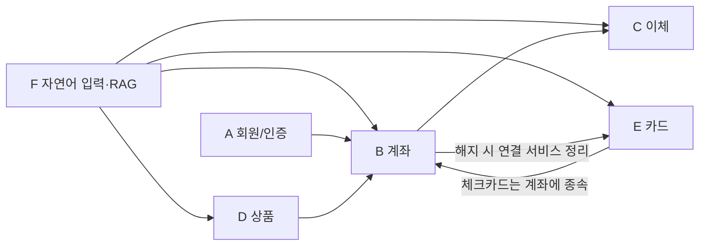
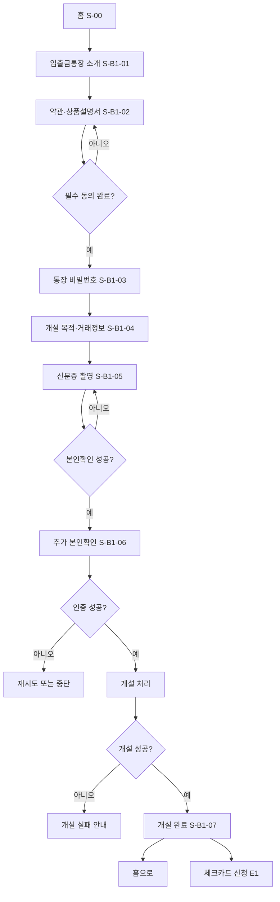
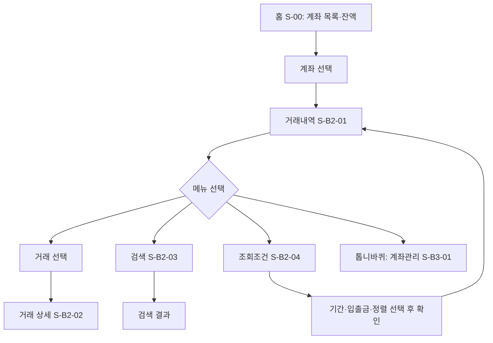
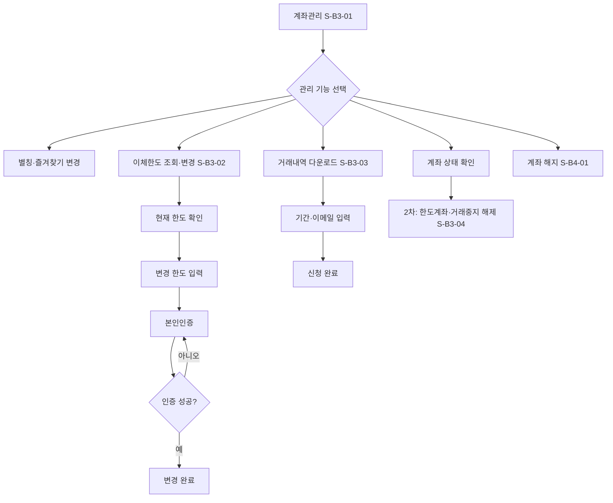
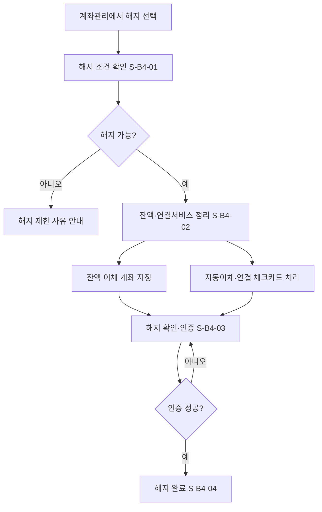
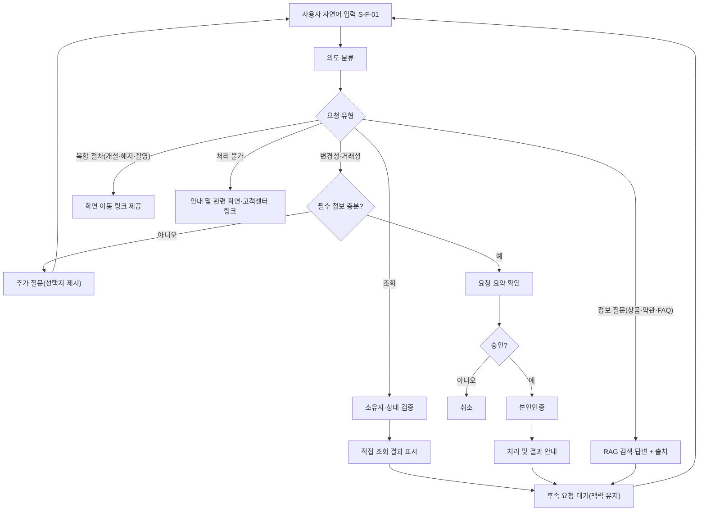
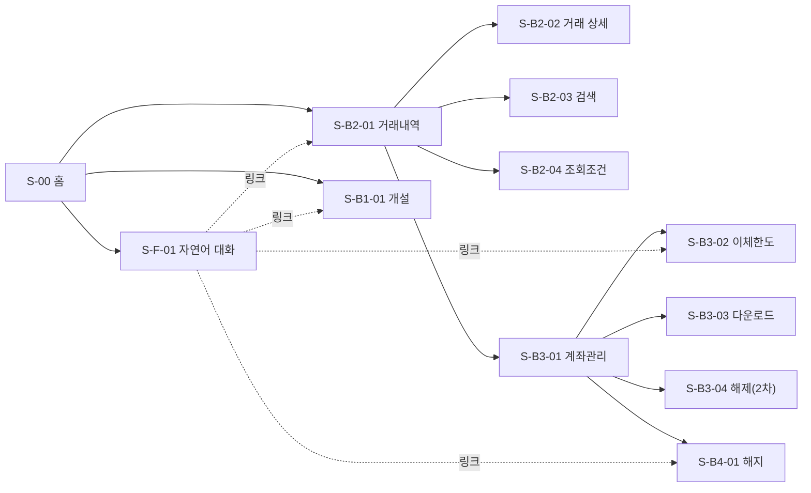

# 은행앱 기능 설계 (취합본)

> 범위: 기능 구조도 · 상세 기능표 · 이용 흐름 · 화면설계 (DB·데이터 모델 제외)
> 상세 수준: 계좌(Account) 도메인은 상세, 나머지 도메인은 구조·요약 수준
> 필수 구현: 자연어 입력(모든 기능을 직접 처리하거나 화면 링크 제공, 맥락 유지, 부족 정보 추가 질문) + RAG

---

## 0. 취합 기준 (자료 간 차이 → 채택안)

| # | 항목 | 기능표 ① | 카카오 기반 ② | 채택 |
| --- | --- | --- | --- | --- |
| 1 | 도메인 경계 | 계좌 안에 이체·예적금 포함 | Account는 생명주기만, 상품은 별도 | 분리: 이체=Transfer, 예적금=Product |
| 2 | 개설 시 이체한도 | 개설 단계에서 설정 | 개설 후 관리에서 변경 | 관리로 이동, 개설 시 기본값 자동 부여 |
| 3 | 개설 순서 | 상품→약관→본인확인→용도→비밀번호 | 약관→비밀번호→목적→신분증→추가인증 | ② 순서 채택, ①의 용도 선택은 목적 입력에 병합 |
| 4 | 즐겨찾기·별칭 | 있음 | 없음 | 유지(계좌 관리에 배치) |
| 5 | 거래내역 다운로드 | 없음 | 있음 | 추가 |
| 6 | 거래내역 검색 | 8개 분류 상세 정의 | 검색어·기간·유형·정렬 | ① 기준을 정의하되 1차는 핵심 항목만 |
| 7 | 계좌 상태 | 정상·거래제한·해지 | 한도계좌·거래중지·해지 | 정상 / 한도계좌 / 거래중지 / 해지로 통일 |
| 8 | 한도계좌·거래중지 해제 | 없음 | 증빙 심사 흐름 | 상태 조회는 1차, 해제 신청은 2차 |
| 9 | 이체한도 메뉴 위치 | 계좌 단위 | 전체 > 인증/보안 | 계좌 관리에 통합, 다른 메뉴에서는 링크 |
| 10 | 계좌 해지 | 카드 처리 규칙 언급만 | 가능 여부 확인·잔액·연결서비스 정리 | ② 흐름 + 연결 카드 처리 규칙 추가 |
| 11 | 권한 검증 | 없음 | 도메인 구성도에 포함 | 포함(자연어 요청 처리의 전제) |
| 12 | 카드 | 별도 섹션 | 내용 비어 있음 | ① 유지, 상세는 후속 보강 |

---

## 1. 기능 구조도

```
은행앱
├─ A. 회원/인증
│   ├─ A1 회원가입
│   ├─ A2 로그인/로그아웃
│   └─ A3 계정 관리
├─ B. 계좌 (Account: 생명주기·상태·소유관계)
│   ├─ B1 개설
│   ├─ B2 조회 (목록·상세·거래내역·다운로드)
│   ├─ B3 계좌 관리 (별칭·즐겨찾기·이체한도·상태 확인)
│   ├─ B4 해지
│   └─ B5 권한·상태 검증 (공통, 화면 없음)
├─ C. 이체 (Transfer)
│   ├─ C1 즉시이체
│   ├─ C2 자동이체·예약이체
│   ├─ C3 최근·자주 쓰는 계좌
│   └─ (2차) 다건이체
├─ D. 상품 (Product)
│   ├─ D1 입출금통장
│   ├─ D2 예금
│   └─ D3 적금
├─ E. 카드
│   ├─ E1 공통 (발급·한도·분실)
│   ├─ E2 체크카드
│   └─ E3 신용카드 (2차)
└─ F. 자연어 입력 (모든 도메인 위의 공통 레이어)
    ├─ F1 대화형 요청 처리
    ├─ F2 맥락 유지·추가 질문
    └─ F3 RAG 질의응답
```

도메인 의존 관계



---

## 2. 상세 기능표

**자연어 처리 범례**
- 직접: 채팅에서 바로 조회·처리
- 직접+확인: 요청 요약 확인 → 인증 → 처리 (변경성 요청)
- 링크: 촬영·약관 동의·되돌릴 수 없는 절차라서 해당 화면으로 이동 링크 제공

### A. 회원/인증 (요약)

| ID | 기능 | 세부 기능 | 출처 | 차수 | 자연어 |
| --- | --- | --- | --- | --- | --- |
| A1 | 회원가입 | 약관 동의(필수/선택), 본인확인(휴대폰·신분증), ID/PW 설정 | ① | 1차 | 링크 |
| A2 | 로그인 | ID/PW, 간편비밀번호(PIN), 생체인증 | ① | 1차 | 해당 없음 |
| A2 | 로그아웃 | 수동, 무활동 자동 로그아웃 | ① | 1차 | 직접+확인 |
| A2 | 보안 | 실패 횟수 제한·잠금, 이상 접속 알림 | ① | 1차 | 해당 없음 |
| A3 | 계정 관리 | 정보 변경, 비밀번호 재설정, 회원 탈퇴 | ① | 1차 | 링크 |

### B. 계좌 (Account) 상세

**B1 개설**

| ID | 기능 | 세부 기능 | 출처 | 차수 | 자연어 |
| --- | --- | --- | --- | --- | --- |
| B1.1 | 상품 안내·선택 | 입출금통장 소개, 신청하기 | ①② | 1차 | 링크 → S-B1-01 |
| B1.2 | 약관·상품설명서 | 상품설명서 확인, 필수/선택 동의, 필수 미동의 시 진행 불가 | ①② | 1차 | 링크 → S-B1-02 (약관 내용 질문은 RAG) |
| B1.3 | 통장 비밀번호 | 4자리 설정·확인 | ①② | 1차 | 링크 → S-B1-03 |
| B1.4 | 개설 목적·거래정보 | 개설 목적 선택, 거래 관련 질문 응답 | ①② | 1차 | 링크 → S-B1-04 |
| B1.5 | 신분증 본인확인 | 신분증 촬영·제출, 실패 시 재촬영 | ②(①본인확인) | 1차 | 링크 → S-B1-05 |
| B1.6 | 추가 본인확인 | 요구된 인증 절차 진행, 실패 시 재시도/중단 | ② | 1차 | 링크 → S-B1-06 |
| B1.7 | 개설 처리 | 최종 비밀번호 확인, 계좌번호 발급·중복 방지, 기본 이체한도 자동 부여, 실패 안내 | ②★ | 1차 | 링크 |
| B1.8 | 개설 완료 | 신규 계좌 정보 확인, 홈 이동 / 체크카드 신청 연결 | ② | 1차 | 링크 → S-B1-07 |

**B2 조회**

| ID | 기능 | 세부 기능 | 출처 | 차수 | 자연어 |
| --- | --- | --- | --- | --- | --- |
| B2.1 | 계좌 목록·잔액 | 전체 계좌, 잔액, 즐겨찾기 상단 고정 | ①② | 1차 | 직접 |
| B2.2 | 계좌 상세 | 계좌번호, 상품, 상태 | ①② | 1차 | 직접 |
| B2.3 | 거래내역 조회 | 일시·금액·거래 후 잔액, 최신순/오래된순 | ①② | 1차 | 직접 + 링크 → S-B2-01 |
| B2.4 | 거래 상세 | 거래일시·금액·상대방·적요 | ② | 1차 | 직접 |
| B2.5 | 조회조건 | 기간, 입금/출금 구분, 정렬 | ①② | 1차 | 직접 (후속 요청으로 조건 추가) |
| B2.6 | 검색 | 1차: 기간, 금액·금액범위, 상대방(입금자명·예금주), 적요·메모, 거래유형(입금·출금·계좌이체·자동이체·카드대금) | ①② | 1차 | 직접 |
| | | 2차: 거래상태(정상·취소·실패), 거래번호, 거래 채널·수단, 거래 후 잔액 | ① | 2차 | 직접 |
| B2.7 | 거래내역 다운로드 | 기간·이메일 입력 후 신청 | ② | 1차 | 직접+확인 |
| B2.8 | 계좌 상태·한도 확인 | 정상/한도계좌/거래중지 상태, 이체한도 현황 | ② | 1차 | 직접 |

**B3 계좌 관리**

| ID | 기능 | 세부 기능 | 출처 | 차수 | 자연어 |
| --- | --- | --- | --- | --- | --- |
| B3.1 | 계좌 별칭 | 설정·변경 | ① | 1차 | 직접+확인 |
| B3.2 | 즐겨찾기 | 등록·해제 (홈 상단 고정) | ① | 1차 | 직접+확인 |
| B3.3 | 이체한도 | 조회(1회·1일), 변경(재인증 필요) | ①② | 1차 | 조회 직접 / 변경 직접+확인 |
| B3.4 | 한도계좌 | 상태 조회 | ② | 1차 | 직접 |
| | | 해제 신청(증빙 제출·질문 응답·심사 결과) | ② | 2차 | 링크 → S-B3-04 |
| B3.5 | 거래중지 | 상태 조회 | ② | 1차 | 직접 |
| | | 해제(공공마이데이터 또는 증빙) | ② | 2차 | 링크 |

**B4 해지**

| ID | 기능 | 세부 기능 | 출처 | 차수 | 자연어 |
| --- | --- | --- | --- | --- | --- |
| B4.1 | 해지 가능 여부 확인 | 잔액, 연결 서비스(체크카드·자동이체·적금), 계좌 상태 점검 | ②★ | 1차 | 직접 |
| B4.2 | 해지 제한 사유 안내 | 사유별 안내와 해결 경로 | ② | 1차 | 직접 |
| B4.3 | 잔액·연결서비스 정리 | 잔액 이체 계좌 지정, 자동이체 해지, 체크카드 처리 | ②★ | 1차 | 링크 → S-B4-02 |
| B4.4 | 해지 확인·인증 | 최종 확인 문구, 비밀번호/생체 인증 (되돌릴 수 없음) | ② | 1차 | 링크 → S-B4-03 |
| B4.5 | 해지 완료 | 결과 확인, 거래내역 보관 안내 | ② | 1차 | 링크 |

**B5 권한·상태 검증 (공통)**

| ID | 기능 | 세부 기능 | 출처 | 차수 |
| --- | --- | --- | --- | --- |
| B5.1 | 소유자 확인 | 요청한 계좌가 본인 소유인지 검증 (자연어 요청에도 동일 적용) | ② | 1차 |
| B5.2 | 상태별 허용 동작 | 아래 표 기준으로 요청 허용/차단 | ★ | 1차 |

계좌 상태별 허용 동작 (제안, 규정 검토 필요)

| 상태 | 조회 | 입금 | 출금·이체 | 관리 변경 | 해지 |
| --- | --- | --- | --- | --- | --- |
| 정상 | O | O | O | O | O |
| 한도계좌 | O | O | 한도 제한 | 일부 | 조건부 |
| 거래중지 | O | 제한 | 불가 | 제한 | 조건부 |
| 해지 | 이력 조회만 | 불가 | 불가 | 불가 | - |

### C. 이체 (요약)

| ID | 기능 | 세부 기능 | 출처 | 차수 | 자연어 |
| --- | --- | --- | --- | --- | --- |
| C1 | 즉시이체 | 계좌번호·금액·받는 분 확인, 이체 비밀번호 확인 | ① | 1차 | 직접+확인 |
| C1 | 이체한도 | 1회·1일 한도 검증 (설정은 B3.3) | ① | 1차 | 직접 |
| C2 | 자동이체 | 주기·시작일·종료일 | ① | 1차 | 직접+확인 |
| C2 | 예약이체 | 일시 지정 | ① | 1차 | 직접+확인 |
| C3 | 최근·자주 쓰는 계좌 | 목록, 별칭 호출("엄마한테") | ① | 1차 | 직접 |
| - | 다건이체 | 여러 수취인 일괄 | ① | 2차 | 링크 |

### D. 상품 (요약)

| ID | 기능 | 세부 기능 | 출처 | 차수 | 자연어 |
| --- | --- | --- | --- | --- | --- |
| D1 | 입출금통장 | 상품 안내 (개설은 B1) | ②★ | 1차 | RAG + 링크 |
| D2 | 예금 | 상품 목록·금리·가입조건 비교, 가입, 만기·중도해지 | ① | 1차 | RAG + 링크 |
| D3 | 적금 | 상품 비교, 가입, 자동 적립 설정, 만기·중도해지 | ① | 1차 | RAG + 링크 |

### E. 카드 (요약, 상세 보강 필요)

| ID | 기능 | 세부 기능 | 출처 | 차수 | 자연어 |
| --- | --- | --- | --- | --- | --- |
| E1 | 공통 | 발급 신청, 목록·상세, 한도 조회·변경, 분실·정지·재발급, 결제 알림 | ① | 1차 | 조회 직접 / 분실·정지 직접+확인 / 발급 링크 |
| E2 | 체크카드 | 연결 계좌 지정, 일일 사용한도, 사용내역, 해외결제 on/off | ① | 1차 | 직접+확인 |
| E3 | 신용카드 | 심사·발급, 이용한도, 청구서·결제일, 결제 계좌, 할부 관리 | ① | 2차 | 링크 |

### F. 자연어 입력 (공통 레이어)

| ID | 기능 | 세부 기능 | 차수 |
| --- | --- | --- | --- |
| F1.1 | 의도 분류 | 요청을 조회 / 변경성 / 복합 절차 / 정보 질문 / 처리 불가로 분류 | 1차 |
| F1.2 | 기능 라우팅 | 구현한 모든 기능은 직접 처리 또는 화면 링크 중 하나로 반드시 연결 | 1차 |
| F1.3 | 화면 이동 링크 | 기능별 대상 화면 ID 매핑, 필요한 값(계좌 등)을 미리 채워 이동 | 1차 |
| F2.1 | 필수 정보 확인 | 계좌·금액·기간 등 부족하면 추가 질문, 선택지 버튼 제시 | 1차 |
| F2.2 | 대화 맥락 유지 | "그 계좌", "거기서 50만원 넘는 것만" 같은 후속 요청 해석 | 1차 |
| F2.3 | 실행 전 확인 | 변경성·금융거래 요청은 요약 확인 → 인증 → 처리 | 1차 |
| F2.4 | 권한·상태 검증 | B5 규칙을 자연어 경로에도 동일 적용 | 1차 |
| F3.1 | RAG 질의응답 | 상품·약관·FAQ 질문에 근거 문서 기반 답변 + 출처 표시 | 1차 |
| F3.2 | 폴백 | 처리 불가·근거 없음일 때 안내 및 고객센터/관련 화면 링크 | 1차 |

> 확인 필요: 지난 미니 프로젝트 RAG의 문서 범위·검색 방식을 F3에 맞춰 반영해야 합니다.

---

## 3. 이용 흐름

### 3-1. 계좌 개설



| 단계 | 화면 | 사용자 행동 | 시스템 처리·분기 |
| --- | --- | --- | --- |
| 1 | S-00 홈 | 계좌 개설하기 선택 | |
| 2 | S-B1-01 | 상품 확인 후 신청하기 | |
| 3 | S-B1-02 | 상품설명서 확인, 필수 동의 | 필수 미동의 시 다음 비활성 |
| 4 | S-B1-03 | 비밀번호 4자리 입력·확인 | 단순 패턴(1234, 0000) 차단 |
| 5 | S-B1-04 | 개설 목적, 거래정보 응답 | |
| 6 | S-B1-05 | 신분증 촬영·제출 | 실패 시 재촬영 |
| 7 | S-B1-06 | 추가 인증 진행 | 실패 시 재시도/중단 |
| 8 | 처리 | 최종 확인 | 계좌번호 발급, 기본 이체한도 부여 |
| 9 | S-B1-07 | 개설 완료 확인 | 홈 이동 또는 체크카드 신청 |

### 3-2. 계좌 조회



| 단계 | 화면 | 사용자 행동 | 시스템 처리·분기 |
| --- | --- | --- | --- |
| 1 | S-00 | 계좌 목록·잔액 확인 (즐겨찾기는 상단) | 소유 계좌만 표시 |
| 2 | S-B2-01 | 계좌 선택 → 계좌번호·잔액·거래내역 확인 | 기본 최신순 |
| 3 | S-B2-02 | 거래 선택 → 일시·금액·상대방 확인 | |
| 4 | S-B2-03 | 검색어 입력 | 상대방·적요·금액 대상 |
| 5 | S-B2-04 | 기간·입출금 유형·정렬 설정 | 설정 후 목록 갱신 |
| 6 | S-B2-01 | 설정 결과 확인 | |

### 3-3. 계좌 관리 (별칭·즐겨찾기·이체한도·다운로드·상태)



| 단계 | 화면 | 사용자 행동 | 시스템 처리·분기 |
| --- | --- | --- | --- |
| 1 | S-B2-01 | 우측 상단 톱니바퀴 선택 | |
| 2 | S-B3-01 | 계좌번호, 상태, 관리 메뉴 확인 | 상태 배지 표시 |
| 3 | S-B3-01 | 별칭 변경, 즐겨찾기 토글 | 즉시 반영 |
| 4 | S-B3-02 | 현재 한도 확인 → 변경 한도 입력 → 인증 | 상위 한도 초과 시 안내 |
| 5 | S-B3-03 | 기간·이메일 입력 후 신청 | 이메일 형식 검증 |
| 6 | S-B3-04 | (2차) 해제 신청·증빙 제출·결과 확인 | 심사 상태 표시 |

### 3-4. 계좌 해지



| 단계 | 화면 | 사용자 행동 | 시스템 처리·분기 |
| --- | --- | --- | --- |
| 1 | S-B4-01 | 해지 조건 확인 | 불가 시 사유 안내(잔액, 거래중지 등) |
| 2 | S-B4-02 | 잔액 이체 계좌 선택, 연결 서비스 확인 | 자동이체 해지, 연결 체크카드 함께 해지 |
| 3 | S-B4-03 | 해지 의사 최종 확인, 인증 | 되돌릴 수 없음 문구 |
| 4 | S-B4-04 | 해지 결과 확인 | 거래내역 보관 안내 |

### 3-5. 자연어 입력



| 단계 | 사용자 입력 예 | 시스템 응답 |
| --- | --- | --- |
| 1 | "월급통장 지난달 입금내역 보여줘" | 소유 확인 → 직접 조회 + [거래내역 화면에서 보기] 링크 |
| 2 | "거기서 50만원 넘는 것만" | 직전 계좌·기간 유지, 금액 조건만 추가 |
| 3 | "한도 올려줘" | 어느 계좌인지, 1회/1일 중 무엇인지, 얼마로 변경할지 추가 질문 |
| 4 | "일 500만원으로" | 요약 확인 카드 → 인증 → 변경 완료 |
| 5 | "예금 중도해지하면 이자 어떻게 돼?" | RAG 답변 + 근거 문서 출처 |
| 6 | "계좌 하나 더 만들어줘" | 개설은 촬영·약관이 필요하므로 S-B1-01 링크 |

---

## 4. 화면설계

### 4-1. 화면 목록

| 화면 ID | 화면명 | 도메인 | 진입 경로 | 주요 구성 요소 | 이동 |
| --- | --- | --- | --- | --- | --- |
| S-00 | 홈 | 공통 | 앱 실행 | 자연어 입력 바, 즐겨찾기·전체 계좌, 잔액, 계좌 개설 버튼, 하단 메뉴 | S-B2-01, S-B1-01, S-F-01 |
| S-F-01 | 자연어 대화 | F | 홈 입력 바 | 대화 말풍선, 결과 카드, 링크 버튼, 선택지 버튼, 입력창 | 모든 기능 화면 |
| S-B1-01 | 입출금통장 소개 | B1 | 홈, 자연어 링크 | 상품 특징, 신청하기 | S-B1-02 |
| S-B1-02 | 약관 동의 | B1 | | 전체 동의, 필수/선택 항목, 상품설명서 보기 | S-B1-03 |
| S-B1-03 | 통장 비밀번호 | B1 | | 숫자 키패드, 확인 입력 | S-B1-04 |
| S-B1-04 | 개설 목적·거래정보 | B1 | | 목적 선택, 질문 응답 | S-B1-05 |
| S-B1-05 | 신분증 촬영 | B1 | | 카메라 가이드, 재촬영 | S-B1-06 |
| S-B1-06 | 추가 본인확인 | B1 | | 인증 수단 선택 | 처리 → S-B1-07 |
| S-B1-07 | 개설 완료 | B1 | | 계좌정보, 홈 이동, 체크카드 신청 | S-00, E1 |
| S-B2-01 | 거래내역 | B2 | 홈 계좌 선택 | 계좌번호·잔액, 거래 목록, 검색·조회조건·톱니바퀴 | S-B2-02~04, S-B3-01 |
| S-B2-02 | 거래 상세 | B2 | 거래 선택 | 일시, 금액, 상대방, 적요, 거래 후 잔액 | S-B2-01 |
| S-B2-03 | 거래 검색 | B2 | 검색 아이콘 | 검색어 입력, 결과 목록 | S-B2-01 |
| S-B2-04 | 조회조건 | B2 | 필터 아이콘 | 기간, 입출금 구분, 정렬, 확인 | S-B2-01 |
| S-B3-01 | 계좌관리 | B3 | 톱니바퀴 | 계좌번호, 상태 배지, 별칭·즐겨찾기, 한도, 다운로드, 해지 | S-B3-02~04, S-B4-01 |
| S-B3-02 | 이체한도 조회·변경 | B3 | 계좌관리 | 현재 1회·1일 한도, 변경 입력, 인증 | S-B3-01 |
| S-B3-03 | 거래내역 다운로드 | B3 | 계좌관리 | 기간 선택, 이메일 입력, 신청 | S-B3-01 |
| S-B3-04 | 한도계좌·거래중지 해제 (2차) | B3 | 계좌관리 | 상태 안내, 증빙 제출, 심사 결과 | S-B3-01 |
| S-B4-01 | 해지 조건 확인 | B4 | 계좌관리 | 해지 가능 여부, 제한 사유 | S-B4-02 |
| S-B4-02 | 잔액·연결서비스 정리 | B4 | | 잔액 이체 계좌, 자동이체·체크카드 목록 | S-B4-03 |
| S-B4-03 | 해지 확인·인증 | B4 | | 되돌릴 수 없음 안내, 인증 | S-B4-04 |
| S-B4-04 | 해지 완료 | B4 | | 결과, 홈 이동 | S-00 |

### 4-2. 화면 이동도 (계좌 도메인)



### 4-3. 주요 화면 와이어프레임

S-00 홈

```
┌ S-00 홈 ─────────────────────────
│ [ 무엇을 도와드릴까요? 입력하세요       ]  → S-F-01
│
│ ★ 즐겨찾기
│   월급통장            3,250,000원
│ 전체 계좌
│   생활비통장            320,000원
│   모임통장               45,000원
│   [ + 계좌 개설하기 ]
│
│ [ 이체 ]  [ 카드 ]  [ 상품 ]  [ 전체 ]
└──────────────────────────────────
```

S-B1-02 약관 동의

```
┌ S-B1-02 약관 동의 ───────────────
│ < 뒤로            입출금통장 개설
│
│ [✓] 전체 동의
│ ─────────────
│ [✓] (필수) 상품설명서 확인          >
│ [✓] (필수) 예금거래 기본약관        >
│ [ ] (선택) 마케팅 정보 수신 동의    >
│
│ [ 다음 ]   ← 필수 미동의 시 비활성
└──────────────────────────────────
```

S-B2-01 거래내역

```
┌ S-B2-01 거래내역 ────────────────
│ < 뒤로   월급통장             [톱니바퀴]
│ 123-456-789012
│ 3,250,000원
│
│ [ 검색 ]  [ 조회조건: 최근 1개월 · 전체 ▼ ]
│ ─────────────
│ 10/25  급여        +3,200,000
│                    잔액 3,250,000
│ 10/22  카드대금      -180,000
│                    잔액    50,000
│ 10/20  김OO 이체     -30,000
│                    잔액   230,000
└──────────────────────────────────
```

S-B2-04 조회조건 (하단 시트)

```
┌ S-B2-04 조회조건 ────────────────
│ 기간     [1개월] [3개월] [6개월] [직접입력]
│ 구분     [전체] [입금] [출금]
│ 정렬     [최신순] [오래된순]
│
│ [ 초기화 ]            [ 확인 ]
└──────────────────────────────────
```

S-B3-01 계좌관리

```
┌ S-B3-01 계좌관리 ────────────────
│ < 뒤로          계좌관리
│ 월급통장  123-456-789012   [정상]
│
│ 계좌 별칭                  월급통장 >
│ 즐겨찾기                   [ ON ]
│ 이체한도 조회/변경                  >
│ 거래내역 다운로드                   >
│ 한도계좌 · 거래중지 상태 확인       >
│
│ 계좌 해지                           >
└──────────────────────────────────
```

S-B3-02 이체한도 조회·변경

```
┌ S-B3-02 이체한도 ────────────────
│ < 뒤로       이체한도 조회/변경
│ 현재 한도
│   1회   5,000,000원
│   1일  10,000,000원
│
│ 변경할 한도
│   1회  [ 입력          ] 원
│   1일  [ 입력          ] 원
│
│ [ 변경하기 ]  → 본인인증 → 완료
└──────────────────────────────────
```

S-B4-02 잔액·연결서비스 정리

```
┌ S-B4-02 해지 정리 ───────────────
│ < 뒤로       해지 전 확인
│ 잔액 3,250,000원
│   받을 계좌  [ 생활비통장 ▼ ]
│
│ 연결된 서비스
│   [!] 자동이체 2건     → 함께 해지
│   [!] 체크카드 1장     → 함께 해지
│
│ [ 다음 ]
└──────────────────────────────────
```

S-F-01 자연어 대화 (조회 → 후속 요청 → 추가 질문)

```
┌ S-F-01 자연어 대화 ──────────────
│ [나]  월급통장 지난달 입금내역 보여줘
│
│ [봇]  2026년 10월 월급통장 입금 3건입니다.
│       ┌ 10/25 급여      +3,200,000
│       ├ 10/12 환급금      +120,000
│       └ 10/03 김OO        +50,000
│       [ 거래내역 화면에서 보기 > ]   ← 링크
│
│ [나]  거기서 50만원 넘는 것만        ← 맥락 유지
│ [봇]  1건입니다. 10/25 급여 +3,200,000
│
│ [나]  한도 올려줘
│ [봇]  어느 계좌의 이체한도를 변경할까요?
│       [ 월급통장 ]  [ 생활비통장 ]    ← 추가 질문
│ ─────────────
│ [ 메시지를 입력하세요        ] [ 전송 ]
└──────────────────────────────────
```

S-F-01 확인 카드 · RAG 답변

```
┌ S-F-01 확인·RAG ─────────────────
│ [봇]  아래 내용으로 변경할까요?
│       ┌ 계좌    월급통장
│       │ 항목    1일 이체한도
│       │ 변경    10,000,000 → 5,000,000원
│       └ [ 취소 ]   [ 인증하고 변경 ]
│
│ [나]  예금 중도해지하면 이자 어떻게 돼?
│ [봇]  중도해지 시 약정 이율이 아닌 중도해지
│       이율이 적용됩니다. ...
│       출처: OO예금 상품설명서 (중도해지 항목)
│       [ 해당 상품 보기 > ]
└──────────────────────────────────
```

---

## 5. 미결정 · 확인 필요

| # | 항목 | 현재 가정 |
| --- | --- | --- |
| 1 | 이체(Transfer) 상세 흐름과 화면 | 구조만 정의, 상세는 후속 |
| 2 | 카드 도메인 상세 | ① 기능표 유지, 자료 보강 필요 |
| 3 | 이체한도의 모바일/ATM 구분 | 1차는 1회·1일 두 가지만 |
| 4 | 계좌 상태별 허용 동작 | 제안안이며 규정(전자금융 관련) 검토 필요 |
| 5 | RAG 문서 범위 | 지난 미니 프로젝트 기준 확인 필요 |
| 6 | 자연어 변경 요청의 인증 방식 | 채팅 내 인증 모달(비밀번호/생체) 가정 |
