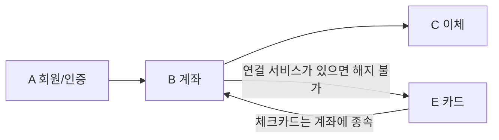

# 은행앱 기능 설계

> 범위: 기능 구조도 · 상세 기능표 (DB·데이터 모델 제외)
> 상세 수준: 계좌(Account) 도메인은 상세, 나머지 도메인은 구조·요약 수준

---

## 1. 기능 구조도

```
은행앱
├─ A. 회원/인증
│   ├─ A1 회원가입
│   ├─ A2 로그인/로그아웃
│   └─ A3 계정 관리
├─ B. 계좌 (Account: 생명주기·상태·소유관계)
│   ├─ B1 개설
│   ├─ B2 조회 (목록·상세·거래내역·다운로드)
│   ├─ B3 계좌 관리 (즐겨찾기·이체한도·상태 확인)
│   ├─ B4 해지
│   └─ B5 권한·상태 검증 (공통, 화면 없음)
├─ C. 이체 (Transfer)
│   ├─ C1 즉시이체
│   ├─ C2 자동이체·예약이체
│   ├─ C3 최근·자주 쓰는 계좌
│   └─ (선택) 다건이체
└─ E. 카드
    ├─ E1 체크카드
    └─ E2 신용카드 (선택)
```

도메인 의존 관계



---

## 2. 상세 기능표

**표 보기**
- 차수: 1차 = MVP 구현 범위, 선택 = 선택사항
- 추가 메모: 구현 관련 메모 (표 맨 오른쪽)

### A. 회원/인증 (요약)

| ID | 기능 | 세부 기능 | 차수 | 추가 메모 |
| --- | --- | --- | --- | --- |
| A1 | 회원가입 | 약관 동의(필수/선택), 본인확인(인증번호 인증), ID/PW 설정 | 1차 | 본인확인은 인증번호 인증 방식 |
| A2 | 로그인 | ID/PW, 간편비밀번호(PIN) | 1차 | PIN 필수 (이후 인증에 계속 편리하게 사용), 생체인증은 제외 |
| A2 | 소셜 로그인 | 소셜 계정으로 로그인 | 선택 | |
| A2 | 로그아웃 | 수동, 무활동 자동 로그아웃 | 1차 | JWT 방식 |
| A2 | 보안 | 실패 횟수 제한·잠금, 이상 접속 알림 | 1차 | |
| A3 | 계정 관리 | 정보 변경, 비밀번호 재설정, 회원 탈퇴 | 1차 | CRUD로 구현 |

### B. 계좌 (Account) 상세

**B1 개설**

| ID | 기능 | 세부 기능 | 차수 | 추가 메모 |
| --- | --- | --- | --- | --- |
| B1.1 | 상품 안내·선택 | 입출금통장 소개, 신청하기 | 1차 | 입출금통장은 상품이 아니라 계좌의 기능으로 포함 |
| B1.2 | 약관·상품설명서 | 상품설명서 확인, 필수/선택 동의, 필수 미동의 시 진행 불가 | 1차 | |
| B1.3 | 통장 비밀번호 | 4자리 설정·확인 | 1차 | |
| B1.4 | 개설 목적·거래정보 | 개설 목적 선택, 거래 관련 질문 응답 | 1차 | |
| B1.5 | 신분증 본인확인 | 신분증 촬영·제출, 실패 시 재촬영 | 선택 | |
| B1.6 | 추가 본인확인 | 요구된 인증 절차 진행, 실패 시 재시도/중단 | 선택 | |
| B1.7 | 개설 처리 | 최종 비밀번호 확인, 계좌번호 발급·중복 방지, 기본 이체한도 자동 부여, 실패 안내 | 1차 | 계좌번호 자릿수 3-4-4 / 기본 이체한도: 1일 100만원, 1달 500만원 (수정 가능) |
| B1.8 | 개설 완료 | 신규 계좌 정보 확인, 홈 이동 / 체크카드 신청 연결 | 1차 | |

**B2 조회**

| ID | 기능 | 세부 기능 | 차수 | 추가 메모 |
| --- | --- | --- | --- | --- |
| B2.1 | 계좌 목록·잔액 | 전체 계좌, 잔액, 즐겨찾기 상단 고정 | 1차 | |
| B2.2 | 계좌 상세 | 계좌번호, 상품, 상태 | 1차 | |
| B2.3 | 거래내역 조회 | 일시·금액·거래 후 잔액, 최신순/오래된순 | 1차 | 거래내역(거래원장): DB에서 가져와서 md로 |
| B2.4 | 거래 상세 | 거래일시·금액·상대방·적요 | 1차 | |
| B2.5 | 조회조건 | 기간, 입금/출금 구분, 정렬 | 1차 | 기본값: 기간 3개월, 구분 전체, 최신순 (수정 가능) |
| B2.6 | 검색 | 기간, 금액·금액범위, 상대방(입금자명·예금주), 적요·메모, 거래유형(입금·출금·계좌이체·자동이체·카드대금) | 1차 | |
| | | 거래상태(정상·취소·실패), 거래번호, 거래 채널·수단, 거래 후 잔액 | 선택 | |
| B2.7 | 거래내역 다운로드 | 기간·이메일 입력 후 신청 | 1차 | |
| B2.8 | 계좌 상태·한도 확인 | 정상/거래중지 상태, 이체한도 현황 | 1차 | 계좌 상태: 정상 / 비활성화(거래중지), 계좌한도 포함 |

**B3 계좌 관리**

| ID | 기능 | 세부 기능 | 차수 | 추가 메모 |
| --- | --- | --- | --- | --- |
| B3.1 | 즐겨찾기 | 등록·해제 (홈 상단 고정) | 1차 | |
| B3.2 | 이체한도 | 조회(1일·1달), 변경(PIN 인증) | 1차 | 계좌 관리의 인증은 PIN 이용 / 기본값 1일 100만원, 1달 500만원 (수정 가능) |
| B3.3 | 거래중지(잠금) | 상태 조회 | 1차 | 거래중지 사유: 비밀번호 오류 누적 |
| | | 해제(본인인증) | 1차 | 비밀번호 오류 누적으로 거래중지 → 본인인증(인증번호)으로 해제 |

**B4 해지**

| ID | 기능 | 세부 기능 | 차수 | 추가 메모 |
| --- | --- | --- | --- | --- |
| B4.1 | 해지 가능 여부 확인 | 잔액, 연결 서비스(체크카드·자동이체), 계좌 상태 점검, 해지 제한 사유 안내 문구 | 1차 | 연결 서비스가 없으면 바로 해지로 진행 / 있으면 제한 사유 안내 문구 표시(해지 차단) |
| B4.2 | 해지 확인·인증 | 최종 확인 문구, PIN 인증 (되돌릴 수 없음) | 1차 | 인증은 PIN |
| B4.3 | 해지 완료 | 해지 상태로 전환(이후 계좌 사용 불가), 거래내역 보관·조회 가능 | 1차 | 해지 후에도 사용한 거래내역 data는 보관하고 조회 가능 |

**B5 권한·상태 검증 (공통)**

| ID | 기능 | 세부 기능 | 차수 | 추가 메모 |
| --- | --- | --- | --- | --- |
| B5.1 | 소유자 확인 | 요청한 계좌가 본인 소유인지 검증 | 1차 | JWT 인증으로 데이터를 가져오며, 이 토큰으로 소유자 확인 |
| B5.2 | 상태별 허용 동작 | 아래 표 기준으로 요청 허용/차단 | 1차 | |

계좌 상태별 허용 동작 (제안, 규정 검토 필요)

| 상태 | 조회 | 입금 | 출금·이체 | 관리 변경 | 해지 |
| --- | --- | --- | --- | --- | --- |
| 정상 | O | O | O | O | O |
| 거래중지 | O | X | X | X | X |
| 해지 | O | X | X | X | X |

### C. 이체 (요약)

이체 도메인 전체: 트랜잭션 처리에 신경 쓸 것

| ID | 기능 | 세부 기능 | 차수 | 추가 메모 |
| --- | --- | --- | --- | --- |
| C1 | 즉시이체 | 계좌번호·금액·받는 분 확인, 이체 비밀번호 확인 | 1차 | 트랜잭션 처리 주의 / 이체를 공통 함수로 구현 |
| C1 | 이체한도 | 1일·1달 한도 검증 (설정은 B3.2) | 1차 | |
| C2 | 자동이체 | 주기·시작일·종료일 | 1차 | 실시간 API로는 구현 불가 → 스케줄러로 구현 (이체 공통 함수 사용), 트랜잭션 처리 주의 |
| C2 | 예약이체 | 일시 지정 | 1차 | |
| C3 | 최근·자주 쓰는 계좌 | 목록, 즐겨찾기(별표·북마크) 표시 | 1차 | |
| - | 다건이체(급여이체) | 여러 수취인 일괄 | 선택 | |

### E. 카드 (요약, 상세 보강 필요)

**E1 체크카드**

| ID | 기능 | 세부 기능 | 차수 | 추가 메모 |
| --- | --- | --- | --- | --- |
| E1.1 | 발급 신청 | 연결 계좌 지정, 일일 사용한도, 해외결제 on/off | 1차 | |
| E1.2 | 목록 조회 | 보유 체크카드 목록 | 1차 | |
| E1.3 | 상세 조회 | 사용내역, 한도 조회·변경, 분실 신고, 정지 | 1차 | |
| E1.4 | 재발급 | 재발급 신청 | 1차 | |
| E1.5 | 결제 알림 | 결제 알림 | 1차 | |
| E1.6 | 부가 기능(상세) | 캐시백, 교통카드 후불 등 | 선택 | |

**E2 신용카드**

| ID | 기능 | 세부 기능 | 차수 | 추가 메모 |
| --- | --- | --- | --- | --- |
| E2 | 신용카드 | 심사·발급, 이용한도, 청구서·결제일, 결제 계좌, 할부 관리 | 선택 | 상품이며 보통 서비스를 분리해서 개발하기 때문에 범위가 너무 커짐 |
